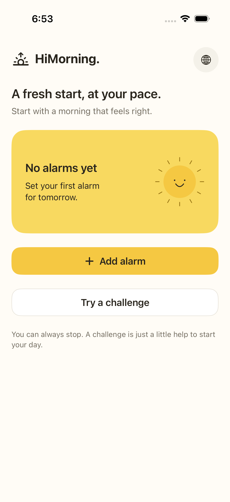
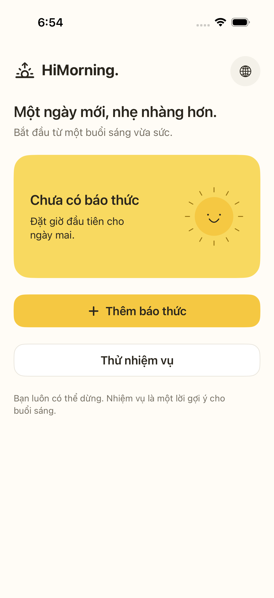
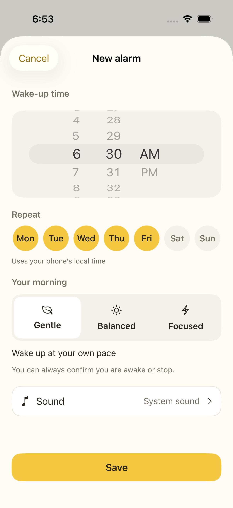
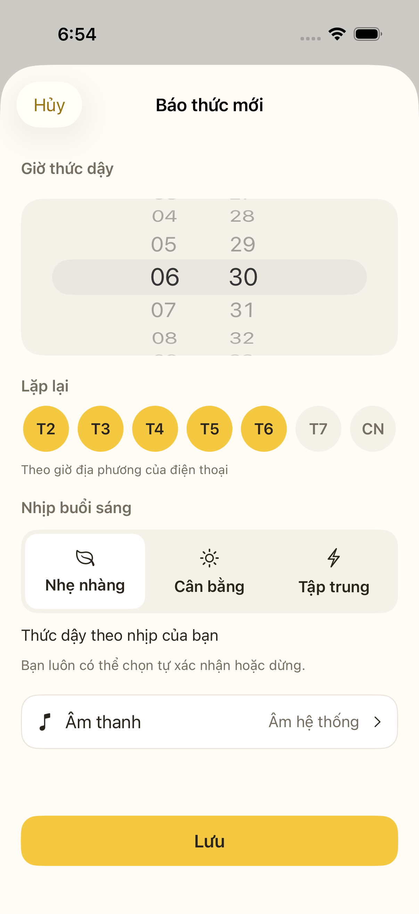
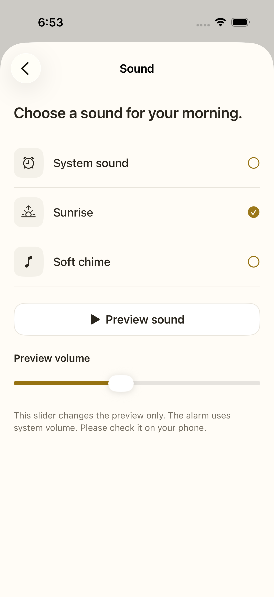
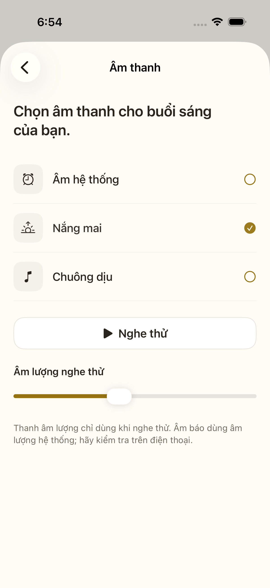
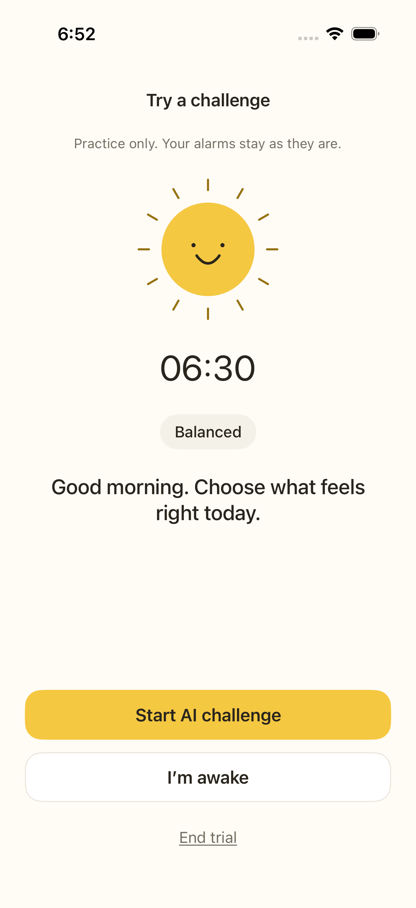
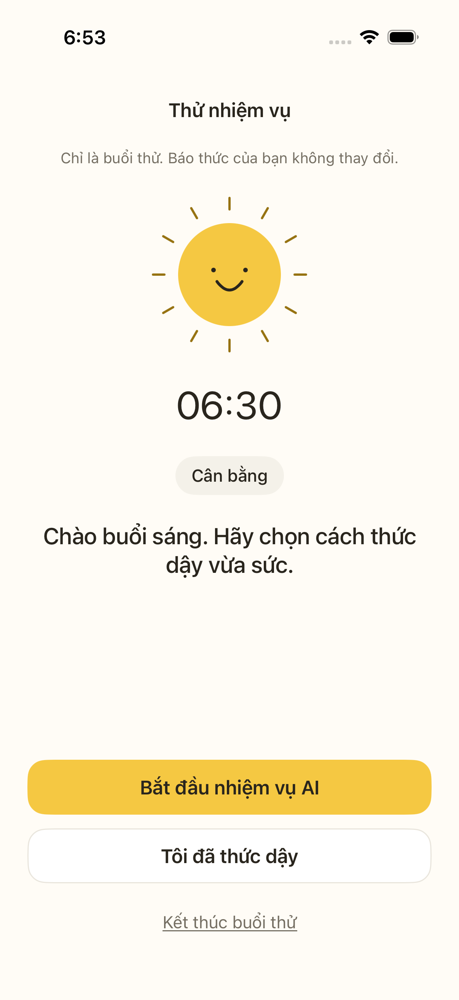
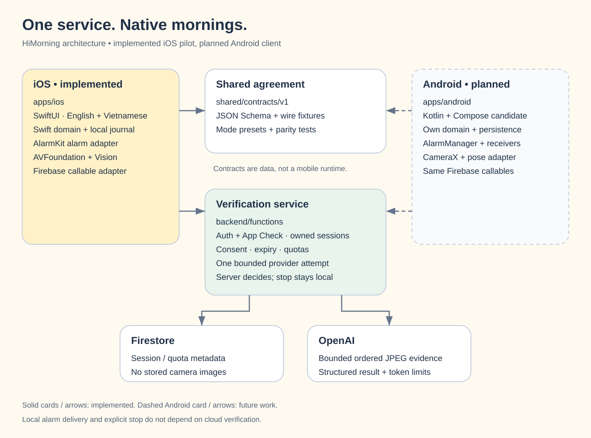

# HiMorning ☀️

A calmer way to start the day. HiMorning is an alarm app with simple choices: wake
up at your own pace, try a small movement challenge, or stop when you need to.

**Status:** iOS 26+ pilot. English and Vietnamese are supported in the native app.
The backend is built and tested, but cloud AI is off by default. This is not a
released or device-validated alarm app.

[GitHub repository](https://github.com/thanhdanh/HiMorning) · [Pull request](https://github.com/thanhdanh/HiMorning/pull/1)

## Start here

| You want to… | Read |
|---|---|
| Run the app or tests | [Setup guide](docs/RUNNING.md) |
| Extend the project to Android | [Android guide](docs/ANDROID.md) and [shared contracts](shared/contracts/README.md) |
| Understand the system | [Architecture](docs/ARCHITECTURE.md) and [tech stack](docs/TECH-STACK.md) |
| Review the experience | [UI guide](docs/UI-DESIGN.md) and [language guide](docs/LOCALIZATION.md) |
| Understand AI costs and safeguards | [Firebase backend](docs/FIREBASE.md) |
| Review the product direction beyond price | [Short rhythm and English activities; validation plan](docs/PRODUCT-BRIEF.md) |
| Review the proposed AI and challenge architecture | [Qwen 9B, self-hosting and local checks](docs/AI-AND-CHALLENGES-PLAN.md) |
| See how AI helped build it | [AI engineering case study](docs/AI-ENGINEERING.md) and [metrics](docs/metrics/README.md) |
| Check what the tests prove | [TDD evidence](docs/tdd/cost-optimized-pilot.tdd.md) |

## A morning with HiMorning

Set a time, choose a mode and pick a sound. The phone's alarm system keeps the
schedule. A regular alarm works without cloud sign-in.

If you choose an AI challenge, the app asks before opening the camera or sending
movement photos to OpenAI. Local movement counts are a preview; the backend must
validate the evidence before reporting AI success. You can always confirm you are
awake or stop. A cloud error must not take away that choice.

| Mode | Suggested challenge | Snooze policy in the core |
|---|---|---|
| Gentle — the default | No exercise required | 2 × 5 minutes |
| Balanced | 3 push-ups | 1 × 5 minutes |
| Focused | 5 push-ups | None |

Native snooze/countdown UI is still planned. Core policy tests do not prove it is
connected to AlarmKit. The app includes system sound and two original chime sketches;
preview volume is separate from alarm volume.

## Quick start

Backend checks need Node 22, pnpm and Java 21:

```sh
corepack enable
pnpm install --frozen-lockfile
pnpm run typecheck
pnpm run build
pnpm run test:coverage
```

Swift core checks work with Apple's Command Line Tools:

```sh
sh scripts/test-swift.sh
```

For the native app, use Xcode 26+ and XcodeGen:

```sh
xcodegen generate --spec apps/ios/project.yml
open apps/ios/HiMorning.xcodeproj
```

The globe menu offers **Use device language**, **English** and **Vietnamese**. Your
choice stays on this device. See [setup](docs/RUNNING.md) for signing and Firebase.

## What is in the repo?

| Path | Purpose |
|---|---|
| `apps/ios/HiMorningCore/` | Alarm domain, local journal, evidence capture and cloud lifecycle |
| `apps/ios/HiMorning/` | SwiftUI, AlarmKit, camera and Firebase adapters |
| `apps/ios/Resources/` | English/Vietnamese strings, permission text and sound sketches |
| `backend/functions/src/` | Firebase callables, OpenAI adapter, session policy and quotas |
| `apps/android/` | Reserved future Android root and extension guide |
| `shared/contracts/v1/` | Language-neutral API schema, wire fixtures and mode presets |
| `tests/` | Backend, emulator, localization and engineering-metrics tests |
| `design/` | Earlier Vietnamese design simulation; no real alarm, camera or API |
| `docs/` | Guides, decisions, plans and evidence |

The working checkout is `~/Projects/HiMorning`. Run `python3 scripts/preview.py` to
view the earlier design study at http://127.0.0.1:4173/design/.

## Native screens

The native app follows the original cream/yellow palette. The
[full gallery](docs/UI-DESIGN.md#native-screens) contains 20 simulator captures:
10 screens/states in English and Vietnamese. A few highlights:

| English | Vietnamese |
|---|---|
|  |  |
|  |  |
|  |  |
|  |  |

See the [UI guide](docs/UI-DESIGN.md#native-screens) and
[capture details](docs/images/ui/README.md). These show the native pilot; the earlier
web study explores additional planned features.

## Architecture at a glance



Android is planned. See the [architecture guide](docs/ARCHITECTURE.md) for boundaries
and [setup](docs/RUNNING.md) for pnpm and Firebase packaging.

## What comes next?

Test alarm delivery, camera placement and sounds on iPhone. Evaluate consented
movement clips for accuracy, delay and cost before enabling AI for users. The
[product brief](docs/PRODUCT-BRIEF.md) proposes short rhythm and practical English
activities to test with users; they are not native features yet. QR,
existing-alarm editing, native snooze, weekly history, deeper form guidance and
Android remain planned. No Firebase project, billing setup or paid OpenAI call was
created during the implementation tests.

Erly's public [App Store](https://apps.apple.com/us/app/erly-wake-up-early/id6751428380)
and [Google Play](https://play.google.com/store/apps/details?id=com.erly.myapp&hl=en)
pages informed the early research. HiMorning has its own copy, artwork and policies.
