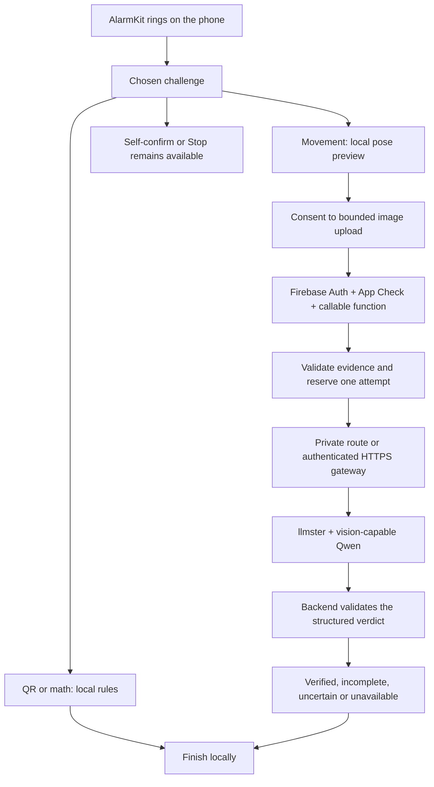

# Affordable AI and more morning choices

Reduce the cost of movement checks and give people a useful choice when exercise
is not right for their morning. Keep the alarm and its exit controls local.

**Status:** Proposed, 13 October 2026. **Audience:** Product and engineering.
The running source still uses the OpenAI adapter with cloud verification off by
default. Qwen, a self-hosted endpoint, QR and math are not implemented or benchmarked.

## At a glance

| Decision | Proposal | What still needs evidence |
|---|---|---|
| Movement model | Try Qwen3.5-4B with vision on existing hardware | Exact runtime/quantization, multi-image support, accuracy, RAM and delay |
| Server | LM Studio's headless `llmster` for a small pilot | Availability, authentication, capacity and a reachable backend route |
| Local challenges | Add QR first, then short math | Native flows, saved settings, accessibility and interruption tests |
| Exercise expansion | Evaluate one movement at a time | Its own capture phases, rules and representative recordings |
| User experience | One challenge choice; short goal; clear exit | English/Vietnamese usability and device checks |

The first saving is avoiding a remote call where ordinary code is enough. A small
local model is a candidate, not evidence of lower total cost or adequate accuracy.

## How it would work

Firebase continues to own identity, sessions, quotas and the final decision policy.
The app never holds the inference-server token. Send a single ordered JPEG batch,
not a live video stream. Preserve the existing 25-frame and one-attempt bounds
initially; reducing evidence needs an accuracy comparison of its own. An outage or
unclear answer must offer another way to finish, without an automatic paid fallback.

`llmster` can run without the desktop UI, on a local machine or a server.
[LM Studio's headless guide](https://lmstudio.ai/docs/developer/core/headless)
describes its daemon and server lifecycle. For an alarm workload, compare a warm
loaded model with cold loading; a sleeping laptop is not an available morning
service. Concurrent users waking around the same time matter more than daily totals.

For development, a backend emulator can reach the model on the same host. A deployed
Firebase function cannot reach a developer laptop through `localhost`; choose an
actual private route or authenticated HTTPS gateway. Keep inference bound to the
host/private network behind that gateway. Enable server tokens explicitly: LM
Studio does not require authentication by default.
[Authentication](https://lmstudio.ai/docs/developer/core/authentication)

## Choosing the model

[Qwen3.5-4B](https://huggingface.co/Qwen/Qwen3.5-4B) has a vision encoder and
Apache-2.0 licensed weights. Start with a vision-preserving quantization that the
installed runtime supports; record its publisher, revision, hash and license.
Compare 9B only if the smaller candidate misses the agreed quality target and the
host can support it. Do not download a text-only conversion for camera verification.
If the chosen runtime cannot serve this exact multimodal build, test a supported
vision model such as [Qwen3-VL-4B-Instruct](https://huggingface.co/Qwen/Qwen3-VL-4B-Instruct)
instead of silently dropping image input.

If the user's “Jev” means TypeSafe's Jev, it is not a direct camera verifier:
its documented inputs are text/JSON, without image, audio or video support.
[Supported state](https://docs.typesafe.ai/concepts/state)
Passing pose summaries to a text decision model would be a different system;
it would inherit missing or incorrect observations. Deterministic pose rules are
cheaper to evaluate first. A different Jev model needs its exact model card.

LM Studio supports JSON Schema output at `/v1/chat/completions`, but warns that
not every model handles structured output well, particularly smaller models.
[Structured output](https://lmstudio.ai/docs/developer/openai-compat/structured-output)
A valid JSON object does not establish that the movement happened. Keep Zod parsing,
frame-order checks, non-overlapping cycles and conservative uncertainty in the backend.
Model-reported confidence alone must not unlock the alarm.

## Cost and effectiveness

Use the same held-out clips, image budget and decision policy for every candidate.
Measure total request latency, not just generated tokens per second. Keep cold-start
results and peak-concurrency results separate from warm single-request results.

| Measure | How to record it |
|---|---|
| False acceptance | Incomplete/ambiguous clips incorrectly marked verified, divided by that labeled group |
| False rejection | Complete visible clips marked incomplete, divided by that labeled group |
| Uncertainty | Uncertain outcomes, reported separately for each labeled group |
| Verified coverage | Correctly verified complete clips divided by all complete clips |
| Waiting | End-to-end p50/p95, cold/warm, timeouts and queue time |
| Capacity | Peak RAM/VRAM, requests at once, failures under a morning burst |
| Cost | Host allocation, electricity or GPU rental, gateway, Firebase and any API charges |
| User effort | Completion time, abandonment, switching challenge and use of Stop |

Split by person before tuning, with varied phones, clothing, lighting, camera angles
and partial/occluded movement. Report counts and uncertainty, not a single accuracy
percentage. Replayed/still evidence is a limitation to test, not a solved liveness
claim. Define acceptable false acceptance, uncertainty and waiting rates before
choosing a production candidate; no target has been approved or achieved yet.

For a monthly comparison, let `F` be allocated fixed host costs, `N` the number of
attempts, `v` variable self-host cost per attempt, and `a` comparable API cost per
attempt. Compare `F + N*v` with `N*a`; break-even is `F/(a-v)` only when `a > v`.
Count idle capacity and failed attempts. Divide total operating cost by correctly
verified sessions as well as by attempts, so cheap incorrect answers do not look
efficient. An already-owned machine still has electricity, maintenance and an
availability cost. No dollar saving is claimed without measurements.

## Challenge choices

These are product proposals; only the existing push-up evidence path is in source.

| Choice | Check | Suitable context | Scope |
|---|---|---|---|
| Push-ups | Local preview plus optional remote image verdict | People who choose exercise and have space | Current pilot; model accuracy unmeasured |
| Scan a QR | Match a locally enrolled random code using the camera | A reason to reach a chosen place | First addition; offline, no AI |
| Short math | Check a small arithmetic answer locally | Quiet/shared rooms, no camera or floor space | Second addition; offline, no AI |
| Walk a little | Platform motion signals | People who prefer walking | Later; permissions and device calibration needed |
| Other movements | A movement-specific pose/evidence policy | People who opt into that movement | Later; not a renamed push-up prompt |

For QR, let the person enroll or print a random code and test it before enabling the
alarm. Do not execute arbitrary QR URLs or upload scanned content. A match means
the code was seen; it does not prove location or resist a copied photo. Always allow
changing the task if the code is lost or the camera is unavailable.

For math, start with addition/subtraction and one to three questions. Explain an
incorrect answer calmly, keep the input large and support interruption. This checks
the answer, not physical wakefulness. Difficulty should be a user's choice, not an
escalating penalty after mistakes.

Keep Gentle/Balanced/Focused as suggested effort levels. Add one compact challenge
selector and only the relevant target, with a trial action before saving. QR needs
no rep count; math needs a question count. Do not expose model/server settings in
the morning flow. Local completion must never be labeled “AI verified”. Avoid
requiring a water-drinking photo, face recognition or long exercise holds merely
to add variety. Technique coaching remains a separate optional proposal in the
[form-feedback plan](POSE-FEEDBACK-PLAN.md), not an alarm unlock condition.

## Implementation scope

The existing `Verifier` port in `backend/functions/src/service.ts` is reusable;
there is no need for a routing framework or another database. These changes must
ship together when the replacement is implemented:

| Area | Required change |
|---|---|
| Provider and entry point | Add one Qwen/LM Studio adapter; select its server-owned config; keep timeout and no retries |
| Configuration | Validated endpoint/model, server-only token, startup/deploy checks and default-off behavior |
| Decision boundary | Same evidence and verdict validation; malformed output, refusal and timeout stay non-success |
| Consent | Name the actual image processor and retention behavior in EN/VI; update consent version and shared fixtures |
| Stored outcomes | Replace provider-specific success for new results; decode historical `openai_verified` safely |
| Telemetry | Record actual provider/model revision, duration, token usage if present and outcome; never images or secrets |
| Native challenges | Save the chosen task/target, migrate older alarms to their existing behavior and keep journal recovery |
| Contracts and tests | Update exported schemas/fixtures only where wire behavior changes; run TypeScript and Swift consumers |
| Guides | Update stack, Firebase setup, privacy copy and architecture only after the deployed behavior is true |

Use executed RED/GREEN cycles for: endpoint/config validation, multi-image request
shape, invalid/refused/truncated output, timeout, quota/idempotency, late success
and legacy outcome decoding. For QR/math, protect enrollment, wrong/correct input,
cancel, offline completion, persistence, interruption and both languages. Do not
route local tasks through Firebase merely to reuse a cloud session.

## What we checked

Reviewed the existing provider port, OpenAI adapter, Firebase entry point, evidence
contract and Swift outcomes, plus the primary sources linked above. The current
consent and `openai_verified` outcome are provider-specific, so swapping only a URL
would leave misleading behavior. No server was installed, no user frames were sent,
and no hardware, model accuracy or inference price was measured in this review.

## Limits and next steps

Obtain the intended Jev link and available GPU/RAM, then run a small multimodal
compatibility check on that exact host. Evaluate consented recordings before
replacing the verifier. Implement QR and math in separate reviewable changes, with
native captures and source evidence. Keep OpenAI disabled rather than automatically
falling back to it. Cloud deployment remains a separate step after configuration
and the image-processing disclosure are reviewable.

## Read next

[Current stack](TECH-STACK.md) · [Architecture](ARCHITECTURE.md) ·
[Implementation plan](IMPLEMENTATION-PLAN.md) · [Metrics](metrics/README.md)
