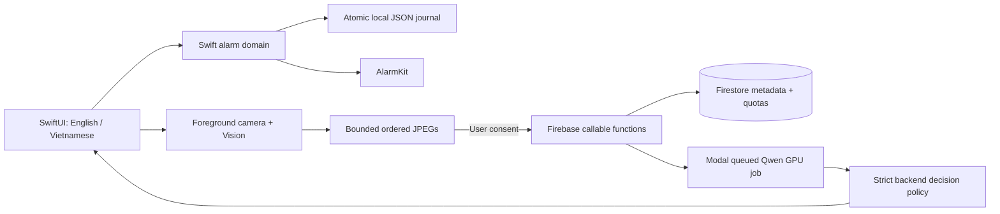
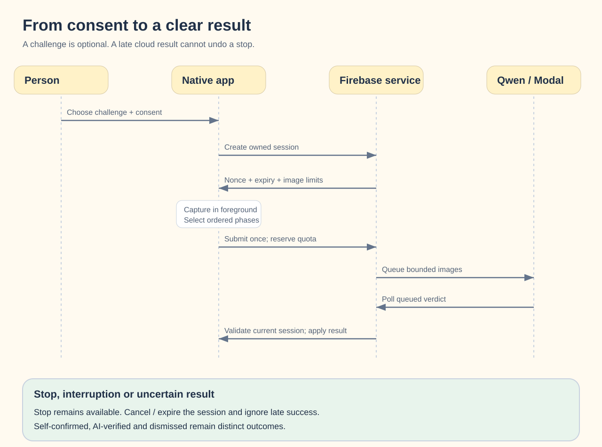
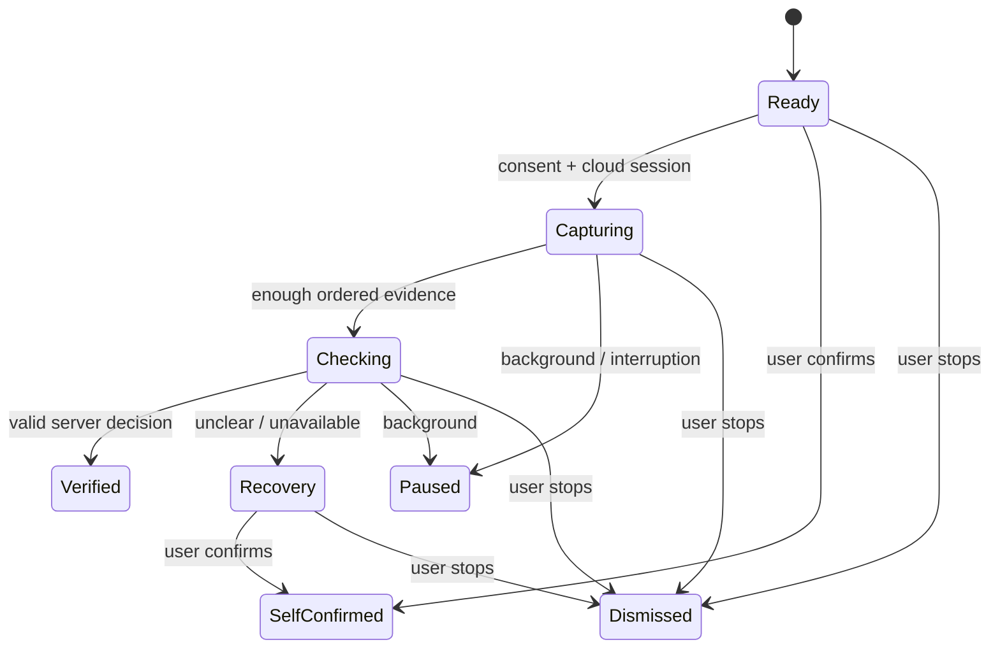

# Architecture

The product challenge flow runs on the iPhone: camera frames feed Apple's body
pose recognition and a bounded push-up counter. No frames are archived or uploaded,
and completion uses `local_completed`. Guided Rhythm and English challenges also
complete locally. See [camera challenge](PUSH-UP-CAMERA.md).

The [free server demo](FREE-REMOTE-DEMO.md) remains a separate developer reference:
Firebase Spark Auth/App Check -> Workers -> SQLite session/quota state -> Gemini.
It accepts generated fixtures only. The Functions/Modal flow below is retained for
separate paid evaluation and is not called by the product challenge screen.

**Status:** iOS 26+ pilot implemented. Device reliability and model accuracy are
not yet validated. Android and several product features remain planned.

## At a glance


The dashed Android card is planned. The iOS app and Firebase service are implemented.
See the [current feature list](../README.md#implemented-pilot) for available activities.

## Repository boundaries

```text
apps/
  ios/                      # SwiftUI, Swift core and Apple adapters
  android/                  # extension guide; app not implemented
backend/functions/          # reusable Firebase service and provider adapter
shared/contracts/v1/        # JSON Schema, wire fixtures and mode presets
tests/                      # service, emulator, contract and tooling checks
scripts/                    # contract export, deployment staging and local checks
design/                     # earlier Vietnamese web concept
docs/                       # guides, diagrams, screenshots and evidence
```

pnpm manages the JavaScript workspace and tooling. SwiftPM/Xcode build iOS; a future
Android project will use Gradle. There is no shared mobile JavaScript runtime.

Server wire schemas live in `backend/functions/src/contracts.ts`. The exported JSON
Schema and shared fixtures let Swift and future Kotlin clients test the same
agreement. TypeScript tests guard schema drift; the portable Swift harness decodes
server fixtures, encodes a matching submission and checks mode presets.

### Key choices

| Choice | Benefit | Cost / alternative |
|---|---|---|
| Separate native app roots | Clear platform ownership; keep existing iOS work | Two client implementations; a cross-platform rewrite is deferred |
| Shared data contracts | Reuse backend and test payload parity across languages | Fixtures need versioning and do not replace native lifecycle tests |
| Pinned pnpm workspace | One development lockfile and explicit dependencies | Toolchain major upgrades need a deliberate validation pass |
| Isolated Firebase stage | Production package includes its own generated lockfile | Run the preparation step before deploy; the stage is not source code |

The pnpm pin is 10.34.6, the published 10.x release used for this Node 22/Corepack
workflow. It is not presented as the newest pnpm major. `pnpm import` carried the
existing dependency resolutions into the workspace; the npm lockfile was removed.
Direct test dependencies are declared explicitly instead of relying on hoisting.

See [shared contracts](../shared/contracts/README.md) and the [Android guide](ANDROID.md)
for extension steps and platform-specific responsibilities.

## Components



| Layer | Current implementation | Responsibility |
|---|---|---|
| UI | `apps/ios/HiMorning/` | Show choices, language, schedule state and recovery |
| Domain | `apps/ios/HiMorningCore/` | Alarm rules, persistence, provisional cycles and lifecycle |
| OS adapter | `NativeAlarmScheduler.swift` | Request access, schedule, cancel, stop and inspect alarms |
| Camera adapter | `CameraCapture.swift` | Foreground capture, local visibility checks and JPEG evidence |
| Cloud client | `FirebaseCloud.swift` | Anonymous Auth, App Check and callable requests |
| Backend | `backend/functions/src/` | Ownership, evidence validation, quotas and authoritative decisions |

SwiftData was considered in the original plan. The current pilot uses an atomic
JSON journal behind a persistence interface. Firestore does not sync or ring alarms.

## Follow one alarm

1. **Save locally.** Validate time and weekdays, then write a pending alarm before
   asking AlarmKit to schedule it.
2. **Confirm the OS result.** Mark it confirmed only after scheduling succeeds.
   Keep a visible review state when the result is unclear.
3. **Recover on launch.** Compare the local journal with the OS inventory. A failed
   write or schedule must not look like a confirmed alarm.
4. **Open the morning flow.** A custom alarm action opens HiMorning. The system's
   own Stop action stays available.
5. **Choose a way to finish.** Self-confirm, stop, or opt into the AI challenge.
   Cloud work is never required for ordinary scheduling or an explicit local stop.

A local file write and an OS alarm registration are separate operations. The journal
and reconciliation handle that gap; there is no shared transaction between them.
Existing-alarm editing, revision sync and a shared intent inbox are future work.

## Follow one AI challenge




1. Obtain explicit consent and create an owned, short-lived server session.
2. Capture only in the foreground. Vision estimates visibility and arm movement.
3. Select five ordered phases for each provisional cycle, within the image budget.
4. Reserve one attempt and daily quota in a Firestore transaction.
5. Dispatch a Modal job outside the transaction and return pending. Poll by session/evidence ID, then validate the structured verdict.
6. Apply a result only if the session is still current, unexpired and not cancelled.

Local counts are provisional. A valid completion needs the requested number of
fully observed, ordered, non-overlapping cycles. Unclear evidence stays uncertain;
it must not become a guessed success. Identity, liveness and safe technique are
not proven by the current model or camera pipeline.

## State and user control



`self_confirmed`, `ai_verified` and `dismissed` (plus historical `openai_verified`) are different outcomes. QR is
planned and must have its own outcome. Stopping an OS alarm does not prove a task
was completed or that someone stayed awake.

Client generations reject late responses. Server cancellation and expiry also win
over cached or late decisions. Backgrounding closes the camera and cancels cloud
work without stopping the OS alarm. An already-started provider request may still
finish and cost money after a client stop.

## Defaults and boundaries

Gentle is the default. Balanced suggests three push-ups; Focused suggests five.
Their tested snooze budgets are 2/1/0, but native countdown/snooze is not wired yet.
Changing language must not change the challenge target or rename an alarm.
Choosing another mode applies its shown preset.

English and Vietnamese copy lives in native localization resources. The app can
follow the device language or save a local choice. System permission prompts use
iOS localization; an in-app choice does not change the phone's settings.

Frames are not saved to Firestore or Storage. Modal Functions can retain encrypted
inputs and outputs for up to seven days, including sent images. Spawned payloads
can be stored in the US even with Southeast Asia compute. Credentials stay on the
server. See the [remote pilot](REMOTE-PILOT.md) for consent and retention details.
Analytics and research consent are separate future decisions.

## What we checked

See [TDD evidence](tdd/cost-optimized-pilot.tdd.md) for actual commands and checkpoints.
Tests cover journal recovery, time validation, quotas, duplicate requests, stop races,
image limits and language fallback. Hosted CI builds the native app and runs UI tests.

Before release, test locked/terminated/restarted states, revoked permissions,
offline use, overlapping alarms, time-zone changes, Bluetooth, Focus and sound
behavior on physical devices. Compare consented clips across people and conditions;
contract tests do not measure exercise accuracy.

## Planned next steps

- Validate native alarm and camera behavior before widening the pilot.
- Add QR enrollment, editing, native snooze and history as separate tested changes.
- Review each form cue with suitable experts before offering technique advice.
- Consider SwiftData, account linking, opt-in sync and StoreKit only when needed.
- Build Android with its own alarm/camera adapters and device tests; do not assume
  iOS behavior carries across.

## Read next

[Tech stack](TECH-STACK.md) · [Firebase](FIREBASE.md) · [UI guide](UI-DESIGN.md) ·
[Form feedback plan](POSE-FEEDBACK-PLAN.md)

Platform references: [AlarmKit](https://developer.apple.com/videos/play/wwdc2025/230/),
[Vision body pose](https://developer.apple.com/documentation/vision/detecting-human-body-poses-in-images),
[Android alarms](https://developer.android.com/develop/background-work/services/alarms).

## Proposed model and challenge update

The current diagrams describe implemented source. The new
[affordable AI and challenge plan](AI-AND-CHALLENGES-PLAN.md) adds a proposed
Qwen/Modal implementation behind the async verifier port, with future QR and math
checked on the phone. These remain separate from the implemented local activities.

## Remote staging

The [remote pilot guide](REMOTE-PILOT.md) is the current deployment source of truth.
Python inference is kept in `backend/inference`; pnpm still manages JavaScript only.
The client submits images once and polls `getVerificationResult` without photos.
Session lifetime is ten minutes; each attempt has a non-reclaimable 180-second
deadline. Stop/cancellation wins over late results. Provider job handles stay private.
