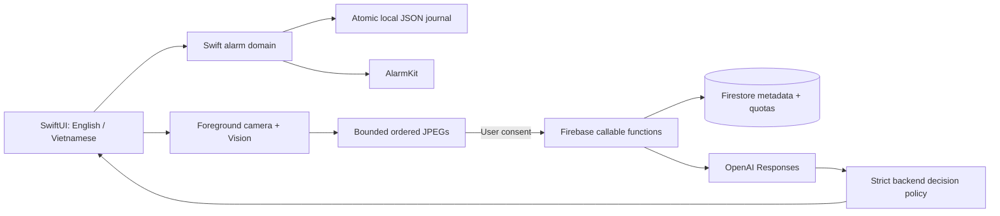
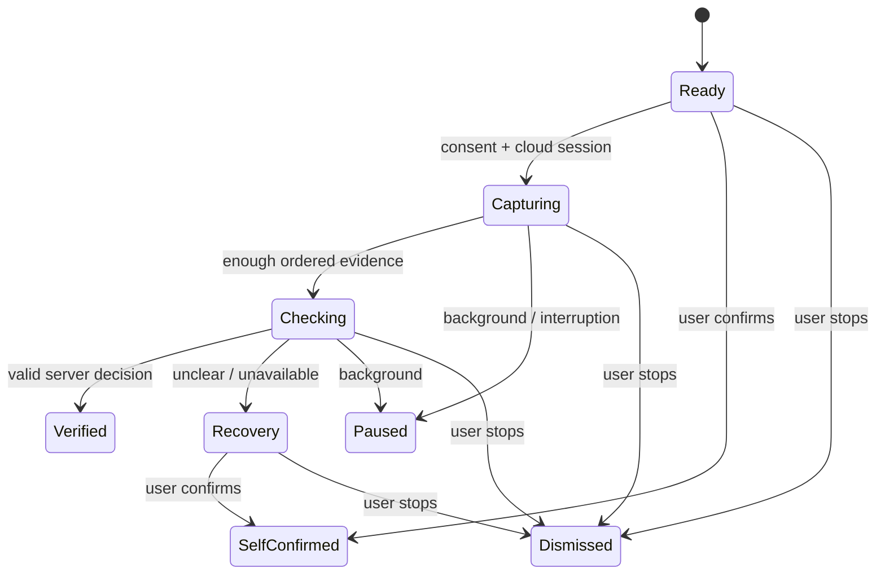

# Architecture

HiMorning keeps the alarm on the phone and uses cloud AI only when a person chooses
a movement challenge. This keeps the morning flow simple and gives users a clear
way out when the camera, network or model cannot help.

**Status:** iOS 26+ pilot implemented. Device reliability and model accuracy are
not yet validated. Android and several product features remain planned.

## At a glance

| Layer | Current implementation | Responsibility |
|---|---|---|
| UI | `ios/HiMorning/` | Show choices, language, schedule state and recovery |
| Domain | `ios/HiMorningCore/` | Alarm rules, persistence, provisional cycles and lifecycle |
| OS adapter | `NativeAlarmScheduler.swift` | Request access, schedule, cancel, stop and inspect alarms |
| Camera adapter | `CameraCapture.swift` | Foreground capture, local visibility checks and JPEG evidence |
| Cloud client | `FirebaseCloud.swift` | Anonymous Auth, App Check and callable requests |
| Backend | `functions/src/` | Ownership, evidence validation, quotas and authoritative decisions |

SwiftData was considered in the original plan. The current pilot uses an atomic
JSON journal behind a persistence interface. Firestore does not sync or ring alarms.

## Follow one alarm

1. **Save locally.** Validate time and weekdays, then write a pending alarm before
   asking AlarmKit to schedule it.
2. **Confirm the OS result.** Mark it confirmed only after scheduling succeeds.
   Keep a visible review state when the result is unclear.
3. **Recover on launch.** Compare the local journal with the OS inventory. A failed
   write or schedule must not look like a confirmed alarm.
4. **Open the morning flow.** A custom alarm action opens HiMorning. The system's
   own Stop action stays available.
5. **Choose a way to finish.** Self-confirm, stop, or opt into the AI challenge.
   Cloud work is never required for ordinary scheduling or an explicit local stop.

A local file write and an OS alarm registration are separate operations. The journal
and reconciliation handle that gap; there is no shared transaction between them.
Existing-alarm editing, revision sync and a shared intent inbox are future work.

## Follow one AI challenge

1. Obtain explicit consent and create an owned, short-lived server session.
2. Capture only in the foreground. Vision estimates visibility and arm movement.
3. Select five ordered phases for each provisional cycle, within the image budget.
4. Reserve one attempt and daily quota in a Firestore transaction.
5. Call OpenAI outside the transaction, then validate the structured verdict.
6. Apply a result only if the session is still current, unexpired and not cancelled.

Local counts are provisional. A valid completion needs the requested number of
fully observed, ordered, non-overlapping cycles. Unclear evidence stays uncertain;
it must not become a guessed success. Identity, liveness and safe technique are
not proven by the current model or camera pipeline.

## State and user control

`self_confirmed`, `openai_verified` and `dismissed` are different outcomes. QR is
planned and must have its own outcome. Stopping an OS alarm does not prove a task
was completed or that someone stayed awake.

Client generations reject late responses. Server cancellation and expiry also win
over cached or late decisions. Backgrounding closes the camera and cancels cloud
work without stopping the OS alarm. An already-started provider request may still
finish and cost money after a client stop.

## Defaults and boundaries

Gentle is the default. Balanced suggests three push-ups; Focused suggests five.
Their tested snooze budgets are 2/1/0, but native countdown/snooze is not wired yet.
Changing language must not change the challenge target or rename an alarm.
Choosing another mode applies its shown preset.

English and Vietnamese copy lives in native localization resources. The app can
follow the device language or save a local choice. System permission prompts use
iOS localization; an in-app choice does not change the phone's settings.

Frames stay in bounded memory and are not saved to Firestore or Storage. OpenAI's
data policies still apply to sent images; `store: false` is not a zero-retention
promise. Credentials stay on the server. Analytics and research consent are separate
future decisions, not implied by challenge consent.

## What we checked

See [TDD evidence](tdd/cost-optimized-pilot.tdd.md) for actual commands and checkpoints.
Tests cover journal recovery, time validation, quotas, duplicate requests, stop races,
image limits and language fallback. Hosted CI builds the native app and runs UI tests.

Before release, test locked/terminated/restarted states, revoked permissions,
offline use, overlapping alarms, time-zone changes, Bluetooth, Focus and sound
behavior on physical devices. Compare consented clips across people and conditions;
contract tests do not measure exercise accuracy.

## Planned next steps

- Validate native alarm and camera behavior before widening the pilot.
- Add QR enrollment, editing, native snooze and history as separate tested changes.
- Review each form cue with suitable experts before offering technique advice.
- Consider SwiftData, account linking, opt-in sync and StoreKit only when needed.
- Build Android with its own alarm/camera adapters and device tests; do not assume
  iOS behavior carries across.

## Read next

[Tech stack](TECH-STACK.md) · [Firebase](FIREBASE.md) · [UI guide](UI-DESIGN.md) ·
[Form feedback plan](POSE-FEEDBACK-PLAN.md)

Platform references: [AlarmKit](https://developer.apple.com/videos/play/wwdc2025/230/),
[Vision body pose](https://developer.apple.com/documentation/vision/detecting-human-body-poses-in-images),
[Android alarms](https://developer.android.com/develop/background-work/services/alarms).
