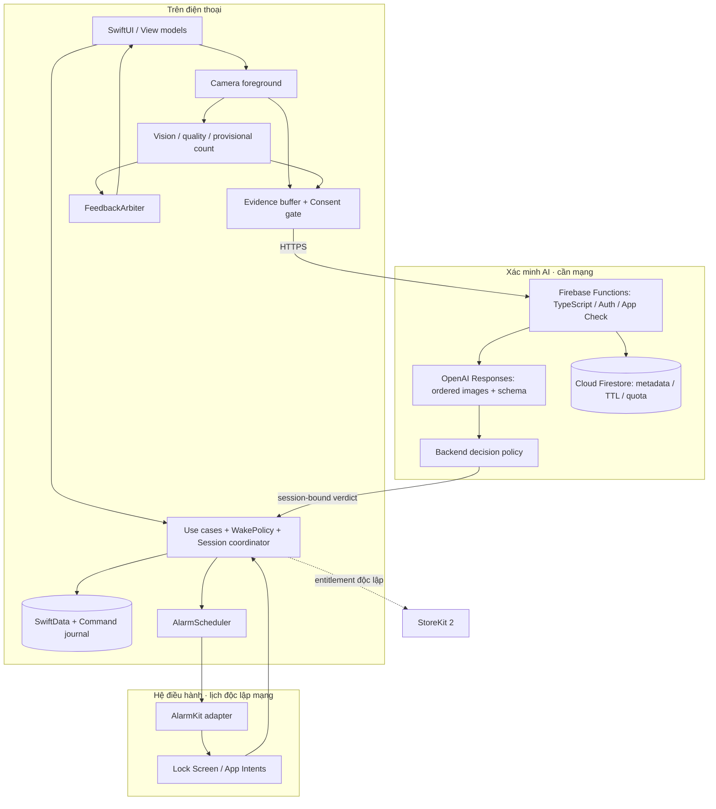
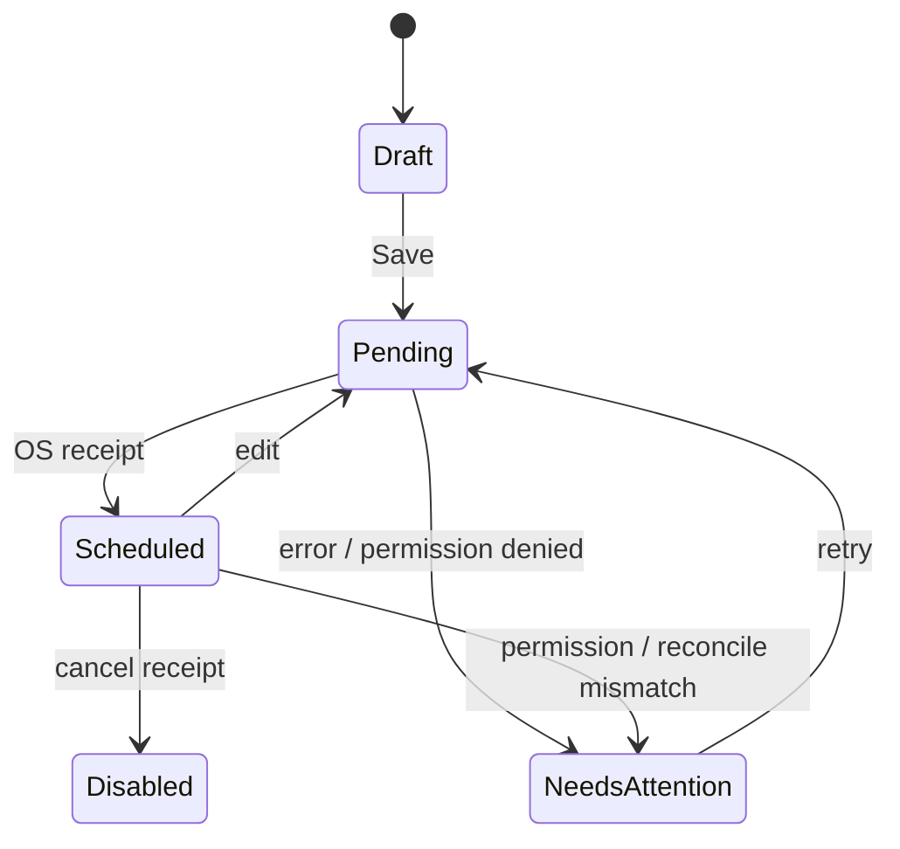
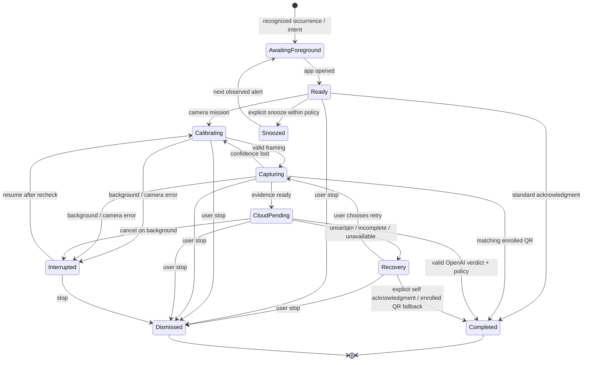

# Kiến trúc đề xuất · HiMorning

**Trạng thái:** kiến trúc mục tiêu; đã triển khai backend, Swift core và native pilot source. Phạm vi hiện tại và phần còn lại nằm trong [RUNNING.md](RUNNING.md). **Ngày:** 11/10/2026. **Cập nhật:** OpenAI tham gia xác minh challenge; xem [tech stack chi tiết](TECH-STACK.md).

Workspace ban đầu trống; không có kiến trúc, quy ước đặt tên, logging, lưu dữ liệu hoặc kiểm thử sẵn có để kế thừa. Mockup web trong `design/` phục vụ review tương tác; không quyết định công nghệ của app phát hành.

## 1. Phạm vi và giả định

- Pilot iOS 26+ bằng SwiftUI đã được người dùng xác nhận. Android nằm trong lộ trình, với adapter native riêng.
- Người dùng chọn cách thức dậy cho từng báo thức: nhẹ nhàng, cân bằng hoặc quyết tâm. Không phân loại tính cách, không tự tăng độ khó hay âm lượng sau một lần bỏ lỡ.
- Báo thức thường hoạt động được ngay; nhiệm vụ vận động hoặc QR là tùy chọn. Báo thức, QR đã enroll và quyền dừng độc lập Internet; challenge xác minh qua OpenAI cần mạng và consent. Không yêu cầu đăng nhập ở onboarding.
- Quyền camera chỉ được hỏi khi thử hoặc sử dụng nhiệm vụ có camera. Camera chỉ hoạt động khi app ở foreground và người dùng mở luồng tương ứng.
- Màu chủ đạo vàng nắng; âm báo được chọn lọc, dễ thử và tách biệt với mức độ khó nhiệm vụ.
- MVP: lịch lặp theo tuần, bỏ qua lần tới, ba preset, sáu âm, chống đẩy và QR, kết quả theo tuần, xử lý lỗi và accessibility. Đồng bộ, social, coaching kỹ thuật sâu và lịch nghỉ lễ tự động để sau. Xác minh challenge qua OpenAI nằm trong phạm vi theo yêu cầu mới.

## 2. Hình tổng thể



Hệ điều hành chịu trách nhiệm đánh thức theo lịch; tiến trình app không chạy timer liên tục để giả lập báo thức. Lỗi analytics hoặc giao dịch không nằm trên đường thực thi của báo thức. API App Intents không được giả định là luôn mở camera ngay trên màn hình khóa.

Apple mô tả AlarmKit với lịch hẹn, âm tùy chỉnh, quyền theo ứng dụng và các nút dừng/báo lại. Điều này không chứng minh khả năng ép người dùng hoàn thành vận động trước khi dừng âm hệ thống. Luồng mở app từ alert cần thử trên thiết bị khóa và mở khóa. [Nguồn: WWDC25 AlarmKit](https://developer.apple.com/videos/play/wwdc2025/230/).

## 3. Module và trách nhiệm

| Module dự kiến | Trách nhiệm | Không sở hữu |
|---|---|---|
| Features/Alarms | Danh sách, editor, ngày lặp, next occurrence, trạng thái đồng bộ | Camera, thanh toán |
| Features/Wake | Hiển thị phiên hiện tại, chỉ dẫn, báo lại, kết thúc | Tính điểm pose trực tiếp |
| Features/Progress | Tổng hợp các kết quả đã ghi nhận; ngày nghỉ trung tính | Khẳng định người dùng còn thức |
| Domain/Alarms | Schedule, WakePolicy, kiểm tra dữ liệu, tính occurrence | SwiftUI, AlarmKit |
| Domain/Sessions | Transition hợp lệ, idempotency, snapshot cấu hình | Video, network |
| Infrastructure/AlarmKit | Translate lịch/âm sang OS; quyền, schedule, cancel, reconcile | Chính sách streak |
| Infrastructure/Camera | Cấp phát/giải phóng capture, orientation, interruption | Đếm rep |
| Infrastructure/Vision | Frame → landmarks/confidence, provisional count hoặc QR payload | Quyết định OpenAI completion |
| Infrastructure/VerificationClient | Consent, gói bằng chứng, deadline, cancel; nhận verdict đúng session | API key, gọi model trực tiếp |
| Backend/Verification | Auth/quota, OpenAI SDK, schema validation, evidence policy, idempotency | Hẹn lịch OS, lưu video mặc định |
| Domain/MovementFeedback | Quality gate, cue tư thế đã kiểm chứng, priority/cooldown | Phạt rep hoặc kết luận người dùng gian lận |
| Infrastructure/Persistence | Repository, migration, giao dịch, command journal | Giao diện |
| Infrastructure/Audio | Catalog, asset validation, nghe thử theo gesture | Cam kết volume hệ thống chưa xác minh |
| DesignSystem | Token màu, chữ, spacing, nút, trạng thái focus/accessibility | Quy tắc nghiệp vụ |

Một target app và widget/intent extension khi cần. Chia thư mục/module logic trước; chỉ tách Swift packages khi có nhu cầu reuse hoặc isolation rõ ràng. Android chia sẻ đặc tả hành vi, token và fixture kiểm thử, không mặc định chia sẻ mã Swift.

## 4. Mô hình dữ liệu

| Entity | Trường chính | Bất biến |
|---|---|---|
| Alarm | id, revision, label, hour/minute, weekdays, timeZonePolicy, enabled, skippedOccurrence, policy, mission, soundID | giờ địa phương + ngày lặp; không lưu mọi lịch lặp dưới dạng UTC cố định |
| WakePolicy | preset, snoozeMinutes, maxSnoozes, missionRequirement | preset chỉ là cấu hình ban đầu; sửa cho lần tới, không đổi giữa phiên |
| MissionConfig | type: none/pushup/qr, targetReps, enrolledCodeDigest, calibrationVersion | target hợp lệ; QR digest không lưu nội dung tùy ý thành analytics |
| SystemRegistration | alarmID, desiredRevision, appliedRevision, systemIDs, syncState, lastErrorCode | chỉ hiện đã đặt khi có receipt phù hợp từ OS |
| WakeSession | sessionID, occurrenceKey, alarmRevision, plannedAt, policySnapshot, state, snoozeUsed, completedAt, outcome | mỗi occurrence tối đa một completion; dùng snapshot của cấu hình khi bắt đầu |
| CommandJournal | commandID, alarmID, revision, operation, stage, retryCount | idempotent; không schedule trùng do retry |
| UserPreferences | locale, theme, optionalReminders, previewVolume, analyticsConsent, aiConsentVersion | previewVolume không được diễn giải là alarmVolume |
| VerificationAttempt | sessionID, evidenceID, policy/model/promptVersion, status, decisionID, expiresAt | local count chưa phải cloud verified; quyết định đến muộn sau stop bị bỏ qua |
| SoundAsset | id, version, localFilename, family, licenseReference, contentHash | asset offline đã được kiểm tra trước khi cho chọn |

`occurrenceKey` được tạo và lưu từ alarmID + lịch/giờ địa phương được resolve + instant thực tế + thông tin timezone/offset. Khóa này không được tạo lại khác nhau từ mỗi callback. Việc tạo registration cho recurring alarm và mapping callbacks cần kiểm chứng trong spike AlarmKit; không giả định OS phát mọi event về app.

## 5. Hợp đồng giữa các lớp

Đây là interface dự kiến, không khẳng định là chữ ký API của Apple:

```text
AlarmScheduler.authorization() -> AuthorizationState
AlarmScheduler.apply(AlarmSnapshot, commandID) -> RegistrationReceipt
AlarmScheduler.cancel(SystemRegistration, commandID) -> CancelReceipt
AlarmScheduler.inventory() -> [ObservedRegistration]
AlarmRepository.saveDesired(Alarm, command) -> Revision
AlarmRepository.markApplied(receipt) -> Void
WakeSessionRepository.apply(event, occurrenceKey) -> TransitionResult
LocalRepEstimator.consume(PoseSample) -> ProvisionalRepEvent
VerificationClient.verify(session, orderedEvidence) -> ServerVerdict
VerificationClient.cancel(session) -> Void
CompletionPolicy.apply(session, ServerVerdict) -> TransitionResult
SoundPreviewPlayer.play(soundID, previewLevel) -> PreviewHandle
SoundPreviewPlayer.stop() -> Void
```

Tất cả lỗi có code máy đọc được + thông điệp tiếng Việt: permissionDenied, scheduleFailed, cameraUnavailable, lowConfidence, verificationUnavailable, verificationUncertain, assetUnavailable, persistenceFailed. Diagnostic logs không ghi ảnh, landmarks, QR payload hoặc nội dung nhãn do người dùng nhập. Native logging dùng OSLog và che dữ liệu nhạy cảm.

## 6. Ghi lịch an toàn và phục hồi

Local DB và AlarmKit không có chung một transaction. Áp dụng command journal và reconciliation:

1. Kiểm tra dữ liệu, quyền cần thiết và asset. Persist desired revision + pending command.
2. Gọi adapter với system identifier ổn định theo alarm/revision strategy đã được xác minh.
3. Nhận receipt, persist applied revision, rồi mới hiển thị trạng thái đã đặt.
4. Khi lỗi, hiển thị “Chưa đặt được báo thức” cùng hành động thử lại/mở cài đặt. Nếu revision cũ vẫn tồn tại, nói rõ lịch nào đang có hiệu lực.
5. Khi mở app hoặc nhận thay đổi quyền/alarm, đối chiếu desired state với inventory hệ điều hành. Replay command chưa hoàn tất bằng cùng idempotency key.
6. Xóa/tắt cũng cần receipt và reconcile. Nếu lịch native bị người dùng dừng hoặc xóa, xử lý theo intent đã biết; không tự tạo lại để đối đầu với hành động dừng của họ.

Trường hợp edit làm OS trả lỗi phải giữ được thông tin lịch cũ và cảnh báo; không hiển thị lịch mới như đã áp dụng. Crash giữa các bước được bao phủ bằng fault-injection tests. Khi local database hỏng, ưu tiên đọc registration từ OS và đưa hướng dẫn phục hồi; không âm thầm xóa lịch native.

## 7. State machine: tách lịch, âm báo và nhiệm vụ





- “Dừng âm hệ thống”, “hoàn thành nhiệm vụ” và “thực sự thức dậy” là ba sự kiện khác nhau. Không dùng nút Stop của OS để ghi verified completion.
- Giờ reo không được quan sát đầy đủ phải hiển thị chưa có dữ liệu, không suy diễn thành thất bại hay missed alarm.
- `outcome` phân biệt `self_confirmed`, `qr_verified`, `openai_verified`, `dismissed`, `unknown`; recovery không được ghi sai nguồn xác nhận. Gentle completion chỉ là tự xác nhận. Mission completion chỉ xác nhận tác vụ; muốn đo còn thức sau 10 phút cần nghiên cứu tự nguyện riêng.
- Dừng khẩn cấp luôn khả dụng trong luồng app, không cần network/payment. Không cộng thành tích verified, không dùng copy phán xét.
- Hết quyền báo lại chỉ ẩn/disable snooze; vẫn giữ hành động hoàn thành hoặc dừng. Không tự chuỗi lại các alarm để cản hệ điều hành.
- Sau background/interruption, ngừng capture; số rep tạm đã ghi nhận có thể giữ kèm bằng chứng còn hợp lệ, nhưng partial rep và calibration phải reset. Server verdict phải khớp session/generation chưa hủy Không cộng rep từ frame cũ hoặc người khác.

## 8. Chính sách ba preset

| Preset | Cấu hình ban đầu | Nhiệm vụ | Snooze |
|---|---|---|---|
| Nhẹ nhàng | mặc định cho báo thức mới | none; có thể tự chọn | 2 × 5 phút |
| Cân bằng | người dùng chọn | gợi ý push-up 3 lần hoặc QR, thử trước khi lưu | 1 × 5 phút |
| Quyết tâm | người dùng chọn | gợi ý push-up 5 lần hoặc QR; có thể sửa | tắt |

Các preset không làm thay đổi soundID. Lần đổi preset đầu tiên có mô tả ngắn về những giá trị thay đổi; không vô tình ghi đè một target đã tự chỉnh. Không bắt buộc vận động để dùng app. Đổi preset khi alarm đang hoạt động áp dụng cho lần sau.

## 9. Camera và xác minh OpenAI

Capture ở foreground → Vision landmarks/quality → bộ lọc theo thời gian và chu kỳ lên–xuống–lên → counter tạm thời. Confidence thấp thì hướng dẫn đặt lại máy; không đoán rep. Chỉ một người trong vùng được quan sát; nhiều người, che khuất hoặc dữ liệu thiếu phải trả chưa đủ bằng chứng. Không khẳng định theo dõi một người đồng nghĩa xác minh identity/liveness.

Chuỗi ảnh được chọn theo từng pha và thời điểm tương đối, gửi qua backend đến OpenAI Responses API sau consent. Backend sử dụng Structured Outputs, kiểm tra evidence IDs, thời hạn phiên và số rep, rồi trả `verified`, `incomplete`, `uncertain` hoặc `unavailable`. Counter local không được tự chuyển sang `openai_verified`. Hợp đồng, model baseline, dữ liệu và lỗi: [TECH-STACK.md](TECH-STACK.md).

Camera landmarks, đếm rep và nhận xét form đều cần fixture và benchmark. Gợi ý kỹ thuật là advisory, có thể tắt; quality/completeness khác form suggestion. Không phát hành cue chỉ vì model tự báo confidence cao. [Kế hoạch posture](POSE-FEEDBACK-PLAN.md).

Frame nằm trong bounded memory trên máy và backend rồi được giải phóng; ảnh đã gửi còn chịu chính sách dữ liệu OpenAI. Không ghi video hoặc lưu ảnh vào storage mặc định. QR xử lý local, dùng mã đã enroll và không tự mở URL. Từ chối camera: thao tác thường hoặc dừng; QR không giải quyết được lỗi thiếu quyền camera.

OpenAI không sẵn sàng: giữ quyền dừng, đề xuất nhiệm vụ dự phòng phù hợp hoặc tự xác nhận; ghi đúng outcome. Không bắt người dùng tập lại vô hạn. Thông số sampling và deadline chưa được coi là đã đạt yêu cầu cho đến khi thử trên thiết bị/mạng thật.

## 10. Âm thanh

Phản hồi động tác được tách khỏi bộ đếm: framing/quality trước, completeness sau, form suggestion là advisory opt-in. Quy tắc không được phát hành chỉ dựa trên confidence landmarks. Xem [kế hoạch gợi ý động tác](POSE-FEEDBACK-PLAN.md) để biết phạm vi pilot và tiêu chí chuyên môn.

- Catalog 6 asset offline với identity ổn định. Ba nhóm âm khác nhau, độc lập với preset.
- Preview chỉ phát sau thao tác, một âm mỗi lúc; tự dừng khi rời trang/background. Preview level lưu riêng.
- Âm tùy chỉnh AlarmKit được xác nhận trong tài liệu Apple. Volume riêng từng alarm, ramp-up, ducking trong lúc làm nhiệm vụ, vòng lặp và audio routing là các câu hỏi của spike thiết bị, không coi là khả năng sẵn có.
- UI MVP dùng chọn âm + nghe thử + bài thử báo thức thực tế. Chỉ đưa control volume hệ thống vào khi có hành vi được kiểm chứng và nhãn chính xác.
- Phát hành cần kiểm tra encoding/duration theo API, peak/loudness, seamless loop, loa thiết bị, Bluetooth/headphones, Focus, silent, thấp pin và tệp thiếu. Nếu asset lỗi dùng fallback hệ thống và thông báo khi phù hợp.

## 11. Lưu trữ, thương mại, privacy

SwiftData sau Repository là đề xuất cho MVP iOS; DB là dữ liệu cục bộ, cần schema version và migration tests. Phần intent/extension dùng App Group inbox nhỏ với atomic writes; chỉ một coordinator được phép tiêu thụ lệnh và cập nhật session để tránh race giữa tiến trình. Việc chọn storage cụ thể cho inbox cần thử khả năng truy cập khi thiết bị khóa; không hạ data protection tùy tiện.

StoreKit 2 được cô lập sau EntitlementProvider. Receipt hoặc subscription lỗi không chặn quyền dừng hoặc lịch đã lưu. MVP có Cloud Functions for Firebase bằng TypeScript để gọi OpenAI, giữ secret trong Secret Manager, quản lý session/quota và quyết định xác minh. Firebase Auth anonymous cấp UID cho cloud; App Check giảm lạm dụng. Firestore chỉ giữ metadata tối thiểu; chưa cần đồng bộ toàn bộ lịch lên cloud. Khi thêm sync, cần opt-in, conflict policy, deletion/retention và kiểm tra luật/quy định hiện hành trước phát hành; tài liệu này không phải kết luận tuân thủ pháp lý.

Consent gửi ảnh cho OpenAI tách khỏi analytics và consent nghiên cứu. Backend không log request body; gọi foreground Responses với `store: false`, không coi đây là zero retention. Copy privacy không được nói toàn bộ ảnh ở lại điện thoại. Xem chính sách dữ liệu và giới hạn trong [tech stack](TECH-STACK.md).

Chi tiết collections, rules, expiry và giới hạn vận hành: [kiến trúc Firebase](FIREBASE.md). Local SwiftData vẫn là nguồn lịch được thực thi trên thiết bị; Firestore sync không tự hẹn báo thức OS.

Analytics tùy chọn: schedule_requested/succeeded/failed, mission_started/completed/dismissed, preview_played, recovery_shown. Chỉ gửi mã lỗi và nhóm thời lượng tối thiểu đã đồng ý; không gửi giờ sinh hoạt chi tiết, hình ảnh, nhãn tự nhập hay pose data. Thiếu callback không được tính là alarm delivery failure. Local diagnostics và nghiên cứu trên thiết bị là bằng chứng riêng cho độ tin cậy.

## 12. Các quyết định đề xuất và đánh đổi

| Lựa chọn | Lý do | Đánh đổi / lựa chọn khác |
|---|---|---|
| Native iOS pilot | Truy cập trực tiếp alarm/camera/lifecycle; dễ cô lập lỗi | iOS 26+ thu hẹp reach; Flutter/React Native vẫn cần module native cho lõi |
| Lịch local + backend AI nhỏ | Alarm native độc lập mạng; OpenAI xác minh nhiệm vụ theo yêu cầu | Challenge AI cần mạng/consent; cần UX lỗi và chi phí vận hành |
| Vision + OpenAI hybrid | Local phản hồi nhanh; cloud xác minh chuỗi bằng chứng | Latency, dữ liệu gửi ngoài thiết bị và false accept/reject phải đo; không bảo đảm chống mọi trick |
| Preset + cấu hình mỗi alarm | Một giao diện cho nhiều mức cam kết | Cần giải thích thay đổi preset để tránh bất ngờ |
| Thành tích theo tuần | Ghi nhận đều đặn, ngày nghỉ trung tính | Không có tác động thúc ép như streak mất toàn bộ |
| Repository + journal | Phục hồi được các thao tác dang dở | Phức tạp hơn save trực tiếp; cần fault injection |

## 13. Android và thay đổi nền tảng

Native Kotlin/Compose + AlarmManager adapter là hướng đề xuất cho giai đoạn tiếp theo. CameraX + MediaPipe Pose Landmarker cho xử lý local và cùng Verification API cho cloud cần benchmark độc lập; không giả định Vision có trên Android. Chính sách và test vectors chung, API alarm native riêng.

Android cần quản lý exact-alarm access theo phiên bản/điều kiện Play, full-screen intent eligibility, notification permissions, audio focus, OEM battery behavior và re-register sau reboot. Lịch lặp chính xác cần tính/schedule occurrence kế tiếp phù hợp; Android repeating alarms thông thường là inexact. Kiểm tra lại tài liệu và policy khi bắt đầu implementation. [Android alarm scheduling](https://developer.android.com/develop/background-work/services/alarms).

Nếu chọn Android-first hoặc cả hai nền tảng, giữ nguyên domain contract và UI spec; đổi thứ tự spike và ước lượng. Không dựng shared-framework trước khi chốt phạm vi nền tảng.

## 14. Kiểm thử và điều kiện phát hành

| Lớp | Kiểm chứng cần có |
|---|---|
| Domain | Snooze budget, weekly schedules, skip-next, DST/timezone, snapshot preset, duplicate event, outcome aggregation |
| Persistence/OS adapter | lỗi giữa save và schedule, crash sau OS receipt trước DB commit, retry trùng, edit/cancel thất bại, reconcile |
| Mission | valid/partial/replayed/no-motion clips, lighting, camera shake, interruptions, user identity change; đo false accept/reject riêng |
| AI / backend | payload quá giới hạn, session hết hạn, 429/timeout/refusal, stale result sau Stop, request trùng, thiếu pha động tác, ảnh lặp; eval theo người và phiên bản model |
| UI | tiếng Việt dài, 200% text, VoiceOver, focus order, reduce motion, light/dark contrast, dừng khẩn cấp |
| Thiết bị | khóa/mở khóa, app terminated, restart, silent, Focus, offline, battery saver, Bluetooth, permission revoked, overlapping alarms |
| Commercial | restore, expiry, offline entitlements; không làm đổi khả năng sử dụng alarm đã lưu |

Mục tiêu UX: ≥90% người thử tự đặt alarm đầu tiên trong 60 giây; thông báo quyền hệ thống được ghi thời gian riêng. Mục tiêu chất lượng: không còn missed alarm không giải thích được trong ma trận đã định và không còn lỗi chặn lối dừng. Đây là acceptance gates trên phạm vi thử, không phải bảo đảm 100% trên mọi máy.

## 15. Thứ tự xây và các câu hỏi cần đóng

1. **Spike native:** OS Stop vs mission, app mở khi khóa, snooze lifecycle, volume/ramp-up, identifiers, inventory và intent storage khi khóa. Ghi ma trận kết quả thực nghiệm.
2. **UI test:** prototype này với các nhóm thói quen/living arrangements; chốt preset/copy/audio families.
3. **Alarm foundation:** repository, journal, adapter, reconciliation và hành vi lỗi trước camera.
4. **Mission + OpenAI:** evidence pipeline, benchmark model, backend session/auth/quota/schema, consent và recovery; triển khai theo [TECH-STACK.md](TECH-STACK.md).
5. **Beta:** đo độ tin cậy + cảm giác làm phiền qua nhiều buổi sáng; tối ưu rồi thêm StoreKit.

Release theo TestFlight cohort nhỏ, rồi mở rộng sau khi gates đạt. Giữ schema migrations tương thích và phiên bản catalog ổn định để rollback app không làm mất nhận dạng âm/lịch. Có kênh hỗ trợ tiếng Việt và diagnostic export do người dùng chủ động, được lọc dữ liệu trước khi chia sẻ.

## Nguồn đã tham khảo

- [Erly App Store screenshots](https://apps.apple.com/us/app/erly-wake-up-early/id6751428380) và [Google Play](https://play.google.com/store/apps/details?id=com.erly.myapp&hl=en): tham khảo UI công khai, không suy diễn implementation nội bộ.
- [AlarmKit WWDC25](https://developer.apple.com/videos/play/wwdc2025/230/): lịch, quyền, custom action, sound và user controls.
- [SwiftData](https://developer.apple.com/documentation/swiftdata): công nghệ persistence đề xuất.
- [Vision body pose](https://developer.apple.com/documentation/vision/detecting-human-body-poses-in-images): landmarks cho verifier.
- [Apple accessibility](https://developer.apple.com/design/human-interface-guidelines/accessibility): tương phản, text size, nhiều phương thức phản hồi.
- [Android alarms](https://developer.android.com/develop/background-work/services/alarms): nền tảng cho adapter giai đoạn sau.

- [OpenAI image inputs](https://developers.openai.com/api/docs/guides/images-vision), [Structured Outputs](https://developers.openai.com/api/docs/guides/structured-outputs), [data controls](https://developers.openai.com/api/docs/guides/your-data): API và giới hạn của luồng cloud đề xuất.
