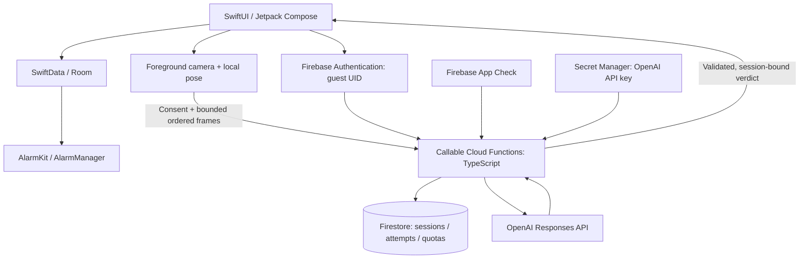

# HiMorning · Firebase architecture

**Status:** proposed stack, updated 2026-10-11. No Firebase project, billing account, deployed function, or production database has been created. The current code is the web design prototype.

## Recommendation

Use Firebase Authentication, Cloud Firestore, and Cloud Functions for Firebase for the MVP. They replace the proposed custom Fastify service and PostgreSQL deployment. Keep the native alarm and local database on the device, and keep OpenAI as the cloud challenge verifier.



## Responsibilities

| Service | HiMorning responsibility |
|---|---|
| Firebase Authentication | Anonymous sign-in when cloud features are used; optional Apple/Google account linking later |
| Cloud Firestore | Minimal profile/preferences when sync is enabled, verification sessions, server decisions, quotas, consent version |
| Cloud Functions, 2nd gen | Authenticate, authorize, validate evidence, enforce quotas, call OpenAI, validate the verdict, handle cancellation |
| Secret Manager | OpenAI secret bound only to the verification function |
| App Check | Additional protection against unauthorized clients; independent of user authorization and rate limits |
| Emulator Suite | Local integration and security-rules testing before deployment |
| Firebase Hosting, optional | Static design previews or a later marketing site |

Anonymous Auth lets guests use protected cloud data and later link credentials to that account. A guest still has an account/UID internally. First sign-in and cloud verification require connectivity; creating an ordinary alarm does not. Account recovery across devices requires a linked sign-in method. [Firebase anonymous authentication](https://firebase.google.com/docs/auth/ios/anonymous-auth).

Callable SDKs attach available Authentication and App Check tokens. Functions must still reject unauthenticated requests, check session ownership, and enforce App Check for released clients. App Check is not evidence that a physical exercise happened. [Callable functions](https://firebase.google.com/docs/functions/callable), [App Check enforcement](https://firebase.google.com/docs/app-check/cloud-functions).

## Data model and authority

```text
users/{uid}                              minimal profile, explicit sync preferences
users/{uid}/alarms/{alarmID}             optional sync copy, revision and originDeviceID
users/{uid}/wakeSessions/{sessionID}     local outcome summary; source explicitly recorded
verificationSessions/{sessionID}        ownerUID, target/variant, nonce, expiresAt, status
verificationSessions/{sessionID}/attempts/{evidenceID}
                                        payloadHash, lease, policy/model version, verdict
quotaBuckets/{uidAndTimeBucket}         server-owned usage counters
```

- Security Rules default to deny. A user can read only their own permitted documents and write only allowed fields in their own preferences/sync records.
- Clients cannot set `openai_verified`, alter quota counters, or write verification attempts. The function owns authoritative verdicts. A client-reported outcome is never trusted as an AI decision.
- Admin SDK access bypasses Firestore Security Rules, so Functions must enforce ownership and input checks explicitly. Use a service account with only the required permissions. [Firestore rules](https://firebase.google.com/docs/firestore/security/get-started).
- Claim an attempt and reserve quota with a Firestore transaction. Call OpenAI **after** the transaction commits, then conditionally finalize the current lease. Do not make a paid model request inside a transaction callback that may run again.
- Check payload hash, session generation, expiry and cancellation when finalizing. If a stop/cancel request fails during a network outage, the app still stops locally and ignores late results; a request already running on the server may still finish and incur cost.
- If a process crashes after inference but before the decision is saved, treat the result as uncertain. Do not promise exactly-once provider billing. Retry remains bounded and idempotent at the app/session layer.
- Firestore TTL cleans up expired metadata, but deletion is asynchronous. Validate `expiresAt` on every server operation; an expired document must never authorize a request. Deleting a parent document does not automatically delete its subcollections, so give attempt documents their own retention policy. [Firestore TTL](https://firebase.google.com/docs/firestore/ttl).

## Local alarms and optional sync

SwiftData/Room and the OS registration journal remain the source of the alarm actually scheduled on a device. Firestore is a sync/metadata store. Neither Cloud Functions, scheduled cloud jobs, nor FCM should be used as the clock that rings the alarm.

Firestore supports offline caching and later synchronization, with last-write-wins behavior for multiple updates to a document. That does not automatically register or reconcile an OS alarm. [Firestore offline behavior](https://firebase.google.com/docs/firestore/manage-data/enable-offline).

For the MVP, keep alarm sync off until conflict policy is implemented. Later, each device reconciles a received revision with its own OS, shows pending/conflicting revisions honestly, and never changes an active challenge midway. User account/sign-in failures must leave the local alarm and stop action usable.

## Camera evidence and OpenAI

Keep camera frames out of Firestore, analytics and crash reports. Send a bounded set of ordered, encoded frames in the callable request, process them in memory, and release references after completion/cancel/deadline. Application payload limits must account for encoding overhead and be tested against Functions limits; insufficient evidence produces `uncertain`, rather than silent truncation and approval.

No Cloud Storage bucket is needed for default challenge verification. If future research needs recorded clips, introduce separate consent, restricted access and retention first. Do not hide image data inside Firestore documents to simplify uploads.

Use `defineSecret` to bind the OpenAI API key to the verification function. Do not put it in the client bundle, Firestore or the Git repository. [Firebase secret parameters](https://firebase.google.com/docs/functions/config-env).

Functions still implement the OpenAI evidence policy described in [TECH-STACK.md](TECH-STACK.md). Firebase does not supply pose verification or guarantee an accurate model verdict. Keep framing feedback local, form advice optional, and `self_confirmed`, `qr_verified`, `openai_verified` and `dismissed` distinct.

## Deployment and operating choices

Deploying Functions requires the pay-as-you-go Blaze plan. Firebase and OpenAI usage are separate costs; local emulators can be used before production deployment. [Firebase Functions setup](https://firebase.google.com/docs/functions/get-started).

Choose a supported region near the initial Vietnam users after measuring latency and reviewing the data flow. Co-locate Functions and Firestore when supported. A nearby Firebase region does not determine OpenAI's inference location.

Measure cold starts, inference p50/p95, uncertain/retry rates, per-session cost and Firestore operations. Configure bounded function concurrency/instances, server quotas, deadlines and a cloud kill switch. Evaluate paid minimum instances only if cold-start measurements justify them. Use platform budget controls and provider spend limits appropriate to the deployment; no billing is being enabled as part of this design update.

## Implementation order

1. Keep the existing prototype working under the HiMorning name.
2. Add emulator-based Auth, callable Functions and deny-by-default Rules when backend implementation begins.
3. Implement session/attempt/lease/quota logic and cancellation without a real model call first.
4. Integrate OpenAI with consented fixtures; measure accuracy, latency and cost before choosing the production model/sampling policy.
5. Integrate native camera/alarms, then test sign-in failure, expired tokens, denied App Check, offline operation, duplicate submissions, 429/timeouts and late responses after Stop.

Account deletion, anonymous-account cleanup, attempt expiry and optional sync deletion need explicit retention behavior before launch. No social features, continuous video upload or background cloud alarm scheduling are required for this MVP.
