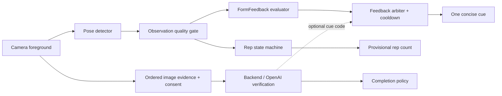

# Kế hoạch: gợi ý động tác trong challenge

**Trạng thái:** đề xuất cho review; mockup chỉ mô phỏng gợi ý, chưa có mô hình nhận diện thật. **Ngày:** 11/10/2026.

## Khuyến nghị

Nên bổ sung để giảm bối rối khi người dùng làm chưa đúng. Mục tiêu là giúp hoàn thành một tác vụ vừa sức, không chấm điểm kỹ thuật hoặc phán đoán người dùng đang gian lận. Bản đầu ưu tiên hướng dẫn đặt máy và động tác trọn vẹn; phản hồi sâu về tư thế nằm sau cổng kiểm chứng chuyên môn và dữ liệu thực tế.

## Phân biệt ba trường hợp

| Tình huống | Kết luận được phép | UX |
|---|---|---|
| Thiếu khớp, confidence thấp, che khuất | Không đủ dữ liệu để nhận xét động tác | “Đặt máy xa hơn để thấy rõ động tác.” Tạm ngừng cộng rep; giữ rep đã xác nhận. |
| Có chuyển động nhưng chưa đủ một chu kỳ | Rep chưa hoàn tất | “Hoàn thành động tác rồi trở về vị trí đầu nhé.” Không trừ rep, không tăng mục tiêu. |
| Landmarks ổn định, đủ góc nhìn, có tín hiệu tư thế lệch lặp lại | Có thể đưa một gợi ý đã được kiểm chứng | Ví dụ có điều kiện: “Thử giữ thân người thẳng hơn.” Nhãn gợi ý, không gán “sai”, không báo gian lận. |

Không nhận xét thẳng lưng hoặc độ sâu khi góc quay không cho phép quan sát. Confidence của landmark không tự tương đương độ tin cậy của kết luận về kỹ thuật. Một tư thế biến thể (chống đẩy gối/tường) không được đánh là sai của tư thế sàn; MVP chỉ hỗ trợ biến thể đã được hướng dẫn và kiểm thử, người không phù hợp chọn QR/báo thức thường.

## Quy tắc sản phẩm

- Gợi ý kỹ thuật là tùy chọn, giải thích trong buổi rehearsal và có thể tắt. Nút tắt gợi ý không thay đổi tiêu chí xác nhận một chu kỳ động tác.
- Một thông điệp mỗi lúc, chữ ngắn, nền vàng dịu. Không phủ kín khung hình/counter. Không có tiếng nhắc liên tục.
- Ưu tiên framing → chất lượng tín hiệu → completeness → form suggestion. Chỉ phát khi hiện tượng ổn định qua một khoảng thời gian, có cooldown và không đổi qua lại từng frame.
- Advisory form feedback không tự bác bỏ một rep đã đáp ứng tiêu chí đếm. Rep không đủ chu kỳ có thể chưa được cộng, nhưng không trừ số đã có, không thêm rep phạt hay tự tăng thời gian chuông.
- Hướng dẫn có ích nhất nằm ở rehearsal trước khi đi ngủ; sáng sớm chỉ đưa cue tối thiểu.
- Nếu khó chịu hoặc không thể hoàn thành, người dùng được dừng hoặc đổi sang lựa chọn phù hợp. Không giữ âm vô hạn vì gợi ý tư thế.
- Không tuyên bố chẩn đoán chấn thương, phục hồi chức năng hay bảo đảm tập đúng/an toàn tuyệt đối.

## Kiến trúc



`FormFeedbackEvaluator` là consumer song song của pose sequence, độc lập với `RepVerifier`. `FeedbackArbiter` chọn tối đa một cue và thực hiện priority/cooldown. Permission denied, low confidence và camera interruption luôn ưu tiên hơn nhận xét form.

Hợp đồng dự kiến:

```text
ObservationQuality = sufficient | insufficient(reason)
RepEvent = progress | completed | incomplete(reason)
FormSuggestion = none | cue(id, confidenceBand, stableDuration, ruleVersion)
FeedbackArbiter.next(quality, repEvent, formSuggestion, preferences) -> DisplayCue?
```

Counter local là tạm thời; OpenAI xác minh challenge qua chuỗi ảnh theo [tech stack](TECH-STACK.md). Cloud cue chỉ thuộc allowlist đã review, không hiện lời khuyên kỹ thuật tự do. Bật/tắt gợi ý không thay đổi consent gửi ảnh cần cho xác minh challenge.

Không lưu landmarks hoặc frames bền vững cho tính năng mặc định; khung hình vẫn được gửi qua backend đến OpenAI khi có consent. Không ghi “chỉ xử lý trên điện thoại”. Dữ liệu đã gửi chịu chính sách retention của nhà cung cấp. Feedback logs cục bộ chỉ chứa cueID/ruleVersion và trạng thái bật/tắt; dữ liệu nghiên cứu video cần consent riêng, mục đích và thời hạn lưu rõ ràng. Tần suất cue không được sử dụng để suy ra sức khỏe hay khả năng thể chất.

## Các bước

1. **Thiết kế + rehearsal:** đưa feedback option vào mockup, minh họa framing/completeness/form ở ba trạng thái riêng. Review với người hay chần chừ, người tập thường xuyên và người mới.
2. **MVP camera + OpenAI:** triển khai framing/confidence, counter tạm, bằng chứng đủ chu kỳ và cloud verdict tách biệt. Đo cue gây nhầm và false rejection; chưa chấm kỹ thuật sâu.
3. **Pilot một cue tư thế:** chuyên gia phù hợp rà soát tiêu chí và copy; dữ liệu nhiều vóc dáng, góc quay, phòng, trang phục. Tách dữ liệu hiệu chỉnh và kiểm thử theo người để tránh leakage.
4. **Mở dần:** chỉ bật rule qua gates; version hóa rules, rollback được. Không tự thay đổi độ khó hoặc tiêu chí đếm của alarm đã lưu qua một model update.

## Kiểm chứng và rủi ro

- **False coaching:** so sánh với đánh giá độc lập của chuyên gia, đo precision/recall từng cue và nhóm điều kiện. Landmark accuracy không thay cho đánh giá cue accuracy.
- **Gây phiền:** so sánh completion time, số lần cue đổi, tỷ lệ tắt gợi ý và cảm nhận áp lực giữa có/không cue. Mục tiêu là hỗ trợ, không chỉ tăng số cue.
- **Overconfidence:** khi ánh sáng/góc nhìn không đạt, phải trả insufficient thay vì đoán. Tạo fixture che vai/hông, quay chính diện, mất frame và nhiều người.
- **Vòng lặp không hoàn thành:** kiểm thử low confidence kéo dài, dừng, resume và camera permission revoked; luôn có đường thoát.
- **Biến thể/cơ thể:** tiêu chí hỗ trợ một biến thể phải được mô tả rõ; không dùng một bộ góc chuẩn cố định cho mọi người.

Các ngưỡng chất lượng cụ thể được chốt trước pilot với người rà soát chuyên môn, không tự đặt “AI đúng 95%” từ dữ liệu chưa có. Phạm vi kỹ thuật này có độ phức tạp cao hơn bộ đếm rep; chỉ phát hành theo từng cue có bằng chứng.

## Nguồn

- [Apple Vision body pose](https://developer.apple.com/documentation/vision/detecting-human-body-poses-in-images): landmark confidence và giới hạn khi che khuất/trang phục/góc nhìn.
- [Apple WWDC20: Body and Hand Pose](https://developer.apple.com/videos/play/wwdc2020/10653/): body pose có thể kém hơn ở tư thế cúi/ngược và bị che khuất.
- [Mayo Clinic: modified pushup](https://www.mayoclinic.org/healthy-lifestyle/fitness/multimedia/modified-pushup/vid-20084674): ví dụ hướng dẫn giữ thân thẳng và chuyển động có kiểm soát. Đây là tham khảo nội dung, không phải bằng chứng camera có thể nhận xét đúng.
