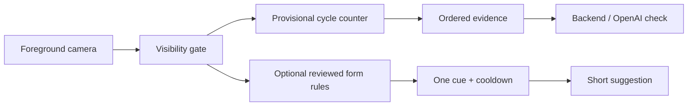

# Movement feedback plan

A person may be trying sincerely and still move in a way the camera cannot read.
Feedback should help them understand what to try next, without blame or pressure.

**Status:** Framing cues and provisional counting exist. Deeper technique coaching
is planned, requires expert review and has not been validated for release.

## Three different questions

| Observation | What the app may say | What it should do |
|---|---|---|
| Body is hidden, cropped or unclear | “Try moving your phone.” | Pause incomplete evidence; keep completed provisional cycles |
| Movement has not completed a cycle | “Return to your starting position.” | Wait; do not subtract reps or raise the target |
| A stable, validated technique signal is visible | A reviewed optional cue | Show one suggestion with a cooldown; do not punish |

The first two are about evidence and completeness. The third is advice. Landmark
confidence is not proof that advice is correct. A knee or wall push-up is a different
variant, not automatically a badly performed floor push-up. Only support variants
with clear instructions and validation; offer a regular alarm or Stop otherwise.

## How the feedback would work

Keep a future form evaluator separate from completion policy. Prioritize camera
access, visibility and incomplete movement before technique suggestions. The current
backend accepts only `none` and `adjust_camera` cue codes; it does not display
free-text model coaching.

## Product rules

- Make advice optional and explain it during rehearsal, before the morning rush.
- Show one short cue without covering the camera or counter; avoid repeated speech.
- A form suggestion must not cancel an otherwise accepted rep, add penalty reps or
  keep sound playing indefinitely.
- Preserve self-confirm and Stop. Turning advice off does not silently change the
  evidence rules or consent needed for cloud verification.
- Do not claim to diagnose injury, provide rehabilitation or guarantee safe form.

## Data boundaries

Default features do not save frames or pose landmarks. Consented challenge images
still travel through the backend to OpenAI, whose data policies apply. Research
clips need separate consent, access controls and retention. Cue frequency must not
be used to infer someone's health or physical ability.

## Build in small steps

1. Review framing and incomplete-cycle copy with beginners and regular exercisers.
2. Measure confusion and false rejection in the existing camera/OpenAI pipeline.
3. Choose one form cue, have suitable experts define its valid viewing conditions,
   and test it with consented data across people, clothing, rooms and angles.
4. Split calibration and holdout sets by person to avoid leakage. Measure cue
   precision/recall and user comfort, not just landmark quality.
5. Release only reviewed rules, version them and keep rollback possible. A model
   update must not silently change the challenge saved in an alarm.

## What would count as useful?

Compare completion time, confusing cue changes, advice opt-out and reported pressure
with and without advice. Include poor light, cropped joints, frontal views, multiple
people, interruption and permission loss. When evidence is insufficient, the right
answer is uncertainty. Set gates before a pilot; do not invent an accuracy target
from unmeasured data.

## Read next

[UI guide](UI-DESIGN.md) · [Tech stack](TECH-STACK.md) · [Architecture](ARCHITECTURE.md)

Technical references: [Vision body pose](https://developer.apple.com/documentation/vision/detecting-human-body-poses-in-images),
[WWDC body and hand pose](https://developer.apple.com/videos/play/wwdc2020/10653/).
