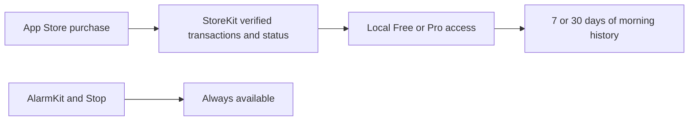

# Monthly Pro and morning progress

Try the paid experience without putting a purchase screen between a person and
their alarm. This guide explains the pilot implementation and the store setup
still needed before accepting real payments.

**Status:** Implemented in the iOS pilot; production products and sandbox/TestFlight
validation are pending. **Audience:** Product owner, iOS developer and reviewer.

## At a glance

| Choice | Pilot behavior |
|---|---|
| Free | All existing alarms, sounds and recovery choices; seven days of progress with a goal of three mornings |
| Pro | Thirty days of history and an editable goal of one to seven mornings per week |
| Monthly product | `com.himorning.pro.monthly`; target US price **$2.99/month**, within the owner's requested $2–3 range |
| Trial | Local StoreKit configuration has one introductory week; configure the actual offer separately in App Store Connect |
| Annual plan | Deferred until the monthly experience is validated; no annual price or product was invented |
| Sharing | Optional system share sheet with a short progress message; no referral reward or tracking yet |

The live price, currency, trial eligibility and renewal terms come from StoreKit.
The app never uses the local test price as a production fallback. No App Store
Connect product or subscription agreement was created by this implementation.

Pro currently covers local progress features. Cloud AI remains a separate pilot
feature with existing quotas and consent; it is not advertised as a Pro benefit.
Charging for cloud AI later requires server-side Apple transaction verification
and durable purchase ownership before changing backend access.

## How it works

1. Open the chart button on Home to review the past seven calendar days.
2. Completed mornings count once per day, even if several alarms are completed.
   AI-checked and self-confirmed results have different labels. Stop is recorded
   as stopped and does not count as completion. Rehearsals never enter history.
3. Open Pro voluntarily. Apple's `SubscriptionStoreView` handles localized
   products, trial terms, purchase approval, restore and offer-code redemption.
4. `SubscriptionStore` accepts verified transactions for the configured monthly
   auto-renewable product. It refreshes from current entitlements at launch,
   foreground entry, progress opening, paywall completion/closing and updates.
5. Expiry or refund returns the progress view to Free. Saved alarms and retained
   history are not deleted. Turning off auto-renew does not immediately revoke
   access during the paid period.



The adapter checks the latest verified subscription status and signed period
boundaries. An expired cached entry cannot grant Pro. Verified grace-period
renewal information can extend access beyond the original transaction expiry.
Transaction and status updates refresh access automatically. Refresh calls are
serialized so a caller awaiting restore does not return before its access result
has been applied. There is no stored
`isPro` boolean to restore stale access after a refund. See [Apple current entitlements](https://developer.apple.com/documentation/storekit/transaction/currententitlements).

## Key choices

- **Native billing:** No RevenueCat dependency, wallet SDK or new Firebase billing
  service is needed for the implemented local benefits.
- **Separate alarm work:** Alarm refresh and StoreKit initialization have separate
  tasks. No challenge Stop action waits for subscription approval or a price lookup.
- **Private progress:** Dates, outcomes and the weekly goal stay in
  `Application Support/HiMorning/mornings.json`. No progress analytics, camera
  recordings or referral contacts are uploaded by this feature.
- **Safe writes:** JSON saves are atomic. Corrupt history pauses history changes;
  a failed save does not undo a successful alarm stop. Clearing history is free.
- **Visible limits:** Free displays seven days; the journal retains up to thirty
  calendar days when new records are written. Inactive files can retain older
  records until another write or explicit clearing; old records are not displayed.
  History does not sync between devices, although eligible Pro access restores.

## Try it

Prerequisites: Xcode 26+, XcodeGen and an iPhone simulator. Local StoreKit testing
does not charge a card or create production products. CI uses the installed iOS
26.2 simulator because newer runner runtimes hit the StoreKitTest CLI regression
described in [Apple Developer Forums](https://developer.apple.com/forums/thread/826971).
Recheck a fixed newer runtime before removing that compatibility pin.

```sh
xcodegen generate --spec apps/ios/project.yml
xcodebuild -project apps/ios/HiMorning.xcodeproj -scheme HiMorning \
  -destination 'platform=iOS Simulator,name=<your available iPhone>' test
```

The native test target loads `apps/ios/StoreKit/HiMorning.storekit` directly. For
manual purchase testing, select that file under **Edit Scheme → Run → Options →
StoreKit Configuration**. The unrelated test product exists only to check product
allowlisting; it is never offered by the app's paywall.

For production, leave local StoreKit simulation disabled and configure the
monthly product in App Store Connect: one subscription group, the product ID
above, the chosen US $2.99 price point and localized availability, and an eligible
one-week introductory offer if desired. Add accurate review notes/screenshots,
public privacy/support URLs, and complete signing and paid-app account setup.
Only offer features that work in the submitted build.

If products do not load, check the selected StoreKit configuration or the real
App Store Connect product setup. Do not display a made-up price or grant access
as a recovery step. Restore through the Apple sheet and return to Progress to
refresh access. Subscription management is available in Progress for Pro users.

## What we checked

- [Portable Swift journeys](../apps/ios/HiMorningCore/TestsPortable/MorningTests.swift):
  duplicate callbacks, rehearsal exclusion, distinct calendar days, future records,
  Free/Pro history windows, downgrade, persistence, clearing and failed writes.
- [Native StoreKit tests](../apps/ios/HiMorningTests/SubscriptionTests.swift):
  purchase, restore, refund, auto-renew cancellation versus expiration, pending and
  cancelled results, unverified data and unrelated products.
- [Bilingual UI journeys](../apps/ios/HiMorningUITests/PilotUITests.swift) and
  [copy checks](../tests/localization.test.ts): progress and Pro discovery in EN/VI,
  plus the existing alarm/rehearsal flows.
- [TDD evidence](tdd/monthly-pro.tdd.md) distinguishes executed local/CI checks
  from sandbox and real-device work still pending.

## Limits and next steps

Real purchases, real Ask to Buy, billing grace/retry, interrupted restores and
production renewals still need sandbox/TestFlight validation. A published privacy
policy, account deletion for existing guest cloud accounts and physical alarm
testing remain release gates. The in-app data explanation is not a substitute
for the public App Store privacy URL.

MoMo, ZaloPay and VNPAY can be Apple Account payment methods in Vietnam; the app
uses StoreKit rather than direct wallet checkout. Recheck current storefront rules
before adding a web payment link. See [Apple payment methods](https://support.apple.com/vi-vn/111741).

## Read next

- [Business model and deferred referral experiments](BUSINESS-MODEL.md)
- [Release readiness](RELEASE-READINESS.md)
- [Apple subscription store view](https://developer.apple.com/documentation/storekit/subscriptionstoreview)
- [Apple sandbox testing](https://developer.apple.com/help/app-store-connect/test-in-app-purchases/overview-of-testing-in-sandbox)
