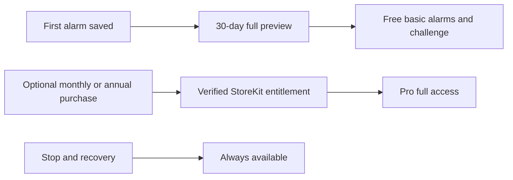
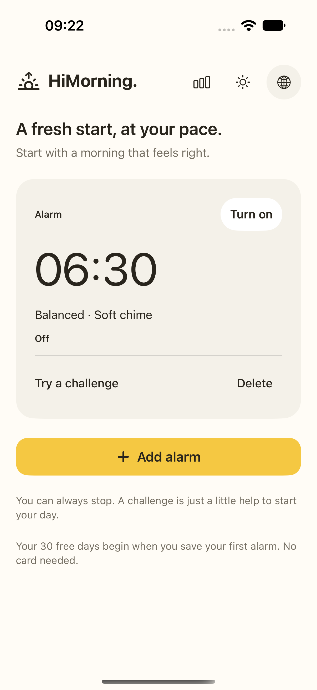
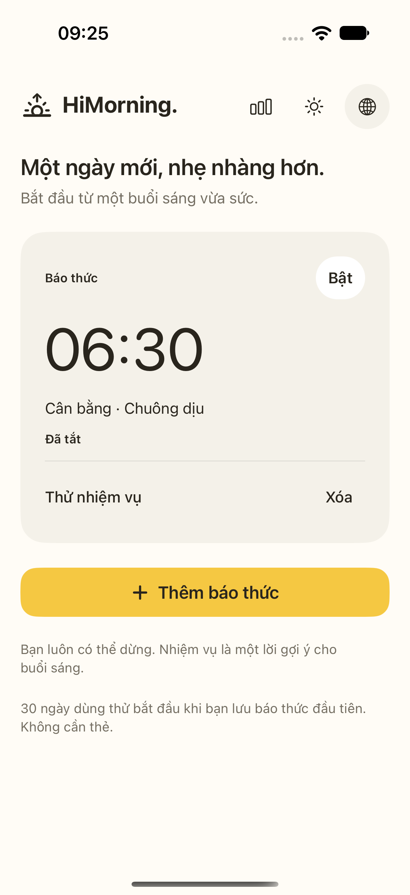
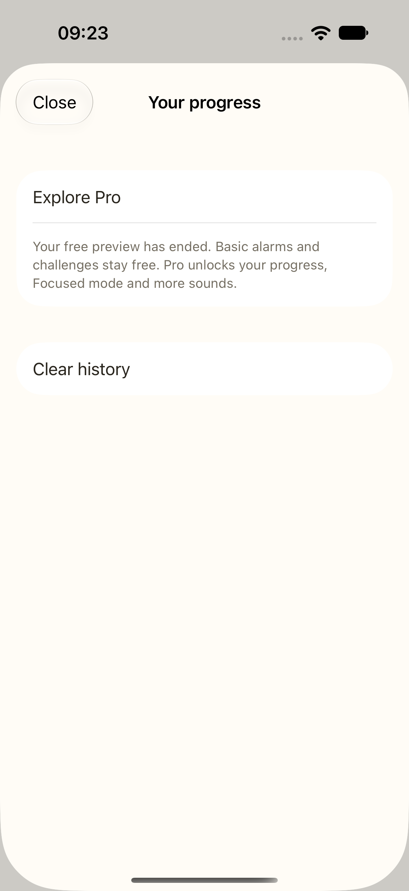
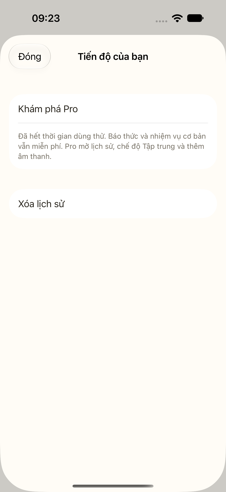

# A full preview, then optional Pro

Let people experience useful mornings before asking them to pay. This guide
explains the 30-day preview, Free fallback and native Apple subscription setup.

**Status:** Implemented with local checks passing on 15 October 2026. Real App
Store products, sandbox/TestFlight billing and physical-device validation remain
pending.
**Audience:** Product owner, iOS developer and reviewer.

## At a glance

| Experience | Access |
|---|---|
| Before the first alarm | Set up and explore the app; the preview clock has not started |
| Full preview | Thirty elapsed days from the first successfully saved alarm; no card, purchase approval or automatic charge |
| Preview and Pro | All current features: Gentle, Balanced and Focused modes, extra sounds, thirty days of local history and a custom weekly goal |
| Free after preview | Alarm scheduling, Gentle mode, Balanced's three push-ups, system sound for new alarms, self-confirmation and Stop |
| Monthly Pro | `com.himorning.pro.monthly`; target US price **$2/month** |
| Annual Pro | `com.himorning.pro.annual`; target US price **$20/year**, in the same subscription group |
| Sharing | Optional system share sheet; no referral reward or attribution yet |

The preview is an app feature, not an Apple introductory subscription offer. It
expires without starting a paid plan. The local StoreKit configuration has no
introductory offer. A paid plan begins only after the person chooses it and
approves Apple's purchase sheet; it then follows the displayed renewal terms.
Live prices and currencies come from StoreKit. Local test prices never replace a
missing production price.

Cloud AI remains a separate consented pilot with its existing quotas. It is not
sold as a Pro benefit. Paid cloud access requires server-side Apple transaction
verification and durable purchase ownership before backend policy can change.

## How it works

1. Save the first alarm successfully. This starts thirty elapsed days of full
   access. A failed save does not consume the preview. For existing pilot users,
   refresh starts a preview only when a confirmed saved alarm exists; an alarm
   still needing review does not qualify.
2. Try the app across real mornings. Completed mornings count once per calendar
   day; Stop and rehearsals do not count. Self-confirmed outcomes remain distinct
   from AI-checked outcomes.
3. Open Pro voluntarily. A nonblocking discovery prompt can appear after three
   completed mornings, outside the active alarm; an explicit Pro button remains
   available. Apple's `SubscriptionStoreView` displays both plans, localized
   prices, renewal terms, purchase approval and restore.
4. At preview expiry, Free keeps scheduling and recovery. History stays on the
   device but its progress view and custom goal require full access. Clearing
   history remains available for privacy.
5. A saved Focused alarm runs a clearly explained Balanced fallback while access
   is Free. Its saved mode is preserved for a later return to full access. Saved
   sounds, including re-enabled alarms, are preserved for reliability. New Free
   alarms use system sound; expiry does not cancel or rewrite existing alarms.



The access decision combines preview dates with verified StoreKit entitlement.
Either paid product grants the same Pro features. Turning off auto-renew leaves
access through the paid period; expiry or revocation removes paid access unless
an active preview remains. Signed grace-period information can extend paid
access. Unrelated, unverified or superseded transactions do not grant it. See
[Apple current entitlements](https://developer.apple.com/documentation/storekit/transaction/currententitlements).

## Key choices

- **Experience before payment:** The preview needs no card or subscription signup.
  Optional discovery follows demonstrated use and never interrupts a ringing alarm.
- **Small native billing layer:** StoreKit 2 handles current local benefits.
  No wallet SDK, RevenueCat dependency or Firebase billing service is needed yet.
- **Local preview protection:** Keychain stores preview start and latest observed
  time. Time never moves backwards for expiry decisions. This limits simple clock
  rollback and often survives reinstall, but is not tamper-proof or a guaranteed
  cross-device entitlement. Firebase plus App Attest/DeviceCheck can be evaluated
  if abuse or paid service costs justify it.
- **Private history:** Outcomes and goals stay in
  `Application Support/HiMorning/mornings.json`. Clearing history does not reset
  the preview. This feature does not upload contacts, recordings or progress events.
- **Alarm reliability:** Access refresh does not cancel alarms or block Stop.
  Expiry changes the available challenge without rewriting saved preferences.
- **Honest scope:** Full access covers implemented local features, not future
  dance, speech, referral rewards or unvalidated AI verification.

## Try it

Use Xcode 26+, XcodeGen and an available iPhone simulator. Local StoreKit testing
neither charges a card nor creates production products.

```sh
xcodegen generate --spec apps/ios/project.yml
xcodebuild -project apps/ios/HiMorning.xcodeproj -scheme HiMorning \
  -destination 'platform=iOS Simulator,name=<your available iPhone>' test
```

Native tests load `apps/ios/StoreKit/HiMorning.storekit`. For manual purchases,
select it under **Edit Scheme → Run → Options → StoreKit Configuration**. The
unrelated product tests allowlisting and is never offered by the app.
CI currently pins iOS 26.2 because of the StoreKitTest CLI issue described in
[Apple Developer Forums](https://developer.apple.com/forums/thread/826971).

For production, disable local StoreKit simulation and create both product IDs in
one App Store Connect subscription group. Set the target US prices of $2/month
and $20/year where supported, configure localized availability and metadata, and leave
introductory offers unset for this model. Complete signing, paid-app agreements,
review screenshots and public privacy/support URLs separately.

If products fail to load, check StoreKit configuration or App Store Connect setup;
do not invent prices or grant paid access. Provide restore and subscription
management even after the preview has ended.

## What we checked

The earlier [monthly Pro TDD record](tdd/monthly-pro.tdd.md) is historical evidence
for the previous monthly-only model. The revised
[no-card preview record](tdd/no-card-preview.tdd.md) tracks the new work separately.

Checks reported on 15 October:

| Scope | Result |
|---|---|
| Portable core journeys | 22 pass; 97.74% core line coverage, not whole-app coverage |
| SwiftPM | 15 tests pass |
| Vitest | 52 tests pass |
| Signed native suite | All 15 pass: 11 billing and 4 PreviewStore tests, including real Keychain read/add/update |
| Signed native coverage | `PreviewStore.swift`: 64/68 lines (94.12%); `Subscriptions.swift`: 86/87 lines (98.85%) |
| Bilingual UI suite | All 8 UI tests pass; the containing earlier bundle also has an unsigned Keychain failure, so that entire bundle is not a pass |
| Signed bilingual expiry UI | One selected test covers English and Vietnamese and passes in a separate signed run |
| Release build | Pass; the compiled executable contains none of the UI-test, expired-preview or language-fixture flags |
| Independent review | No high- or medium-priority findings |

Two failures improved the checks. An unsigned Keychain test returned `-34018`
because its access entitlement was missing. The fix uses one app-specific
Keychain group and simulator-scoped ad-hoc signing; native CI tests now use
signing. The signed suite verifies real persistence instead of relying only on
in-memory storage.

The original `expireSubscription` test mutation reported an expired test
transaction while the verified signed entitlement still had a future expiry and
subscribed status. Its cause is not established. Tests now use an injected clock
(production defaults to `Date`) against real verified signed expirations and
past purchases. This validates access decisions; simulator expiry-event
propagation remains a manual follow-up. The original UI-runner startup failure
is recorded separately from the later passing UI suite.

Relevant source and test boundaries are the [core](../apps/ios/HiMorningCore/),
[native StoreKit tests](../apps/ios/HiMorningTests/SubscriptionTests.swift),
[UI journeys](../apps/ios/HiMorningUITests/PilotUITests.swift) and
[copy checks](../tests/localization.test.ts). Validation results belong in a dated
TDD record; this guide does not claim unexecuted checks passed.

## Native examples

These are actual captures from passing UI tests. The first row uses an unstarted
preview fixture; an existing disabled sample alarm is still visible. The second
uses an expired preview and hides history while keeping its clear action available.
The captures demonstrate access states, not an App Store purchase.

| State | English | Vietnamese |
|---|---|---|
| Before the first alarm |  |  |
| Free after preview expiry |  |  |

See the [native gallery](UI-DESIGN.md#native-screens) for setup, sound and recovery
screens. Neither test fixture grants a backend entitlement.

## Limits and next steps

Real purchase, Ask to Buy, grace/retry, interrupted restore and renewals still need
sandbox/TestFlight validation. Physical alarm testing, public privacy/support
pages and cloud-account deletion remain release gates. Keychain preview protection
is appropriate for a local beta; it must not authorize a paid cloud quota.

MoMo, ZaloPay and other available Vietnam payment methods are configured with
Apple for StoreKit purchases. Direct wallet or bank checkout is separate work and
needs a fresh storefront-policy review. See
[Apple payment methods](https://support.apple.com/vi-vn/111741).

## Read next

- [Business model and proposed outcome metrics](BUSINESS-MODEL.md)
- [Release readiness](RELEASE-READINESS.md)
- [Apple subscription store view](https://developer.apple.com/documentation/storekit/subscriptionstoreview)
- [Apple sandbox testing](https://developer.apple.com/help/app-store-connect/test-in-app-purchases/overview-of-testing-in-sandbox)
