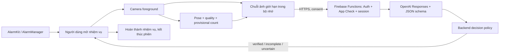

# HiMorning · Tech stack · Native alarm + Firebase + OpenAI

**Ngày:** 11/10/2026. **Trạng thái:** kiến trúc đề xuất; prototype chưa gọi API, mở camera hay đặt báo thức thật. Đây là stack cho concept của dự án, không phải khẳng định stack nội bộ của Erly/Jake.

## Stack đề xuất

| Lớp | Công nghệ | Vai trò |
|---|---|---|
| iOS pilot | Swift, SwiftUI, Swift Concurrency | UI tiếng Việt, ba preset, luồng thức dậy; giả định iOS 26+ cần chốt theo nhóm khách hàng |
| Báo thức iOS | AlarmKit, App Intents, ActivityKit khi cần | OS giữ lịch và hiển thị alert; phối hợp mở phiên trong app |
| Camera iOS | AVFoundation + Apple Vision | Capture foreground, kiểm tra khung hình, landmarks và đếm chuyển động tạm thời |
| Android tiếp theo | Kotlin, Jetpack Compose, AlarmManager, CameraX, MediaPipe Pose Landmarker | Cùng đặc tả sản phẩm; adapter alarm/camera native và benchmark pose riêng |
| AI cloud | OpenAI Responses API + model nhận ảnh + Structured Outputs | Xác minh bằng chứng chuyển động, trả kết quả có cấu trúc và cue được phép |
| Backend | Cloud Functions for Firebase (2nd gen), TypeScript, supported Node.js runtime, Firebase Admin SDK, OpenAI SDK, Zod | Session, kiểm tra payload, rate limit, gọi model, kiểm tra kết quả, giữ bí mật API key |
| Dữ liệu thiết bị | SwiftData trên iOS; Room trên Android | Lịch, preset, âm, kết quả và journal phục hồi; lịch báo thức không phụ thuộc server |
| Authentication | Firebase Authentication | Guest anonymous UID khi dùng cloud; có thể link Apple/Google về sau, không chặn đặt báo thức offline |
| Dữ liệu server | Cloud Firestore | Session expiry, idempotency, consent version, quota và metadata vận hành tối thiểu; không lưu ảnh mặc định |
| Bảo vệ API | Firebase App Check + Auth checks + server quotas | Giảm lạm dụng; không thay cho authorization hoặc chứng minh người đang tập |
| Âm thanh | Asset có bản quyền trong app; AVFoundation / audio API native | Nghe thử có kiểm soát, âm báo offline; volume hệ thống kiểm chứng trên máy thật |
| Triển khai | Firebase CLI / Functions, Emulator Suite, Cloud Secret Manager | Không cần Fastify, PostgreSQL hoặc container riêng cho MVP; chọn region sau khi đo latency từ Việt Nam và rà soát dữ liệu |
| Theo dõi chất lượng | OSLog / Logcat, OpenTelemetry, crash reporting đã lọc | Lỗi alarm, thời gian xác minh, token/cost, fallback; không log frame, payload ảnh hay nhãn riêng |
| Kiểm thử / phát hành | XCTest/XCUITest; JUnit/Compose tests; Vitest + Firebase Emulator Suite/Rules tests; GitHub Actions; TestFlight/Play testing | Domain, native lifecycle, API contract, model eval và thử trên thiết bị |
| Thuê bao về sau | StoreKit 2 / Google Play Billing | Entitlement riêng; không chặn quyền dừng một phiên đang diễn ra |

Chọn native vì alarm, camera và app lifecycle là phần cốt lõi. Backend và đặc tả hành vi dùng chung cho hai nền tảng. Không cần vector database, RAG, agent framework hoặc microservices cho nhiệm vụ xác minh này.

## OpenAI phân tích gì?

MVP đề xuất trích **chuỗi ảnh theo thứ tự từ camera**, kèm thời điểm tương đối và đoạn chuyển động cần kiểm chứng, rồi gửi đến Responses API. API hỗ trợ nhiều ảnh trong một request; số ảnh ảnh hưởng token và chi phí. Đây là lựa chọn thiết kế dùng đầu vào ảnh, không mô tả endpoint này như một luồng video thô liên tục. [OpenAI image inputs](https://developers.openai.com/api/docs/guides/images-vision).

Ứng viên baseline để benchmark: `gpt-5.6-terra`, hỗ trợ ảnh đầu vào và Structured Outputs; trang model không hỗ trợ video đầu vào. Pin snapshot còn được hỗ trợ sau khi đo trên dữ liệu thật, lưu model/prompt/policy version cùng quyết định. Đây chưa phải lựa chọn đã chứng minh đủ chính xác hoặc có latency phù hợp. [Model capabilities](https://developers.openai.com/api/docs/models/gpt-5.6-terra).



1. Người dùng chọn challenge AI và đồng ý gửi khung hình; không hỏi quyền camera khi tạo alarm thường.
2. Khi mở nhiệm vụ, app tạo session có hạn dùng. OS vẫn phụ trách lịch, app chỉ capture khi foreground.
3. Bộ xử lý trên máy phản hồi framing và đếm **tạm thời**. Một vòng lên–xuống–lên phải có bằng chứng theo thời gian; một ảnh đúng tư thế không chứng minh một lần chống đẩy.
4. App chọn ảnh bao phủ các pha của từng rep, gồm pha chuyển tiếp, giữ thứ tự và timestamp bằng text rõ ràng. Không chỉ lấy ảnh đẹp ở hai đầu. Không đưa số rep do client báo thành sự thật cho model.
5. Backend gửi các ảnh đến OpenAI. Model đánh giá từng đoạn được quan sát, trả `complete`, `incomplete` hoặc `uncertain`, kèm evidence frame IDs. Cần kiểm tra kết quả bị từ chối, cắt ngắn hoặc không parse được.
6. Backend đối chiếu session, độ phủ bằng chứng và kết quả local/cloud. Chỉ `verified` hợp lệ mới kết thúc challenge AI thành công; app thực hiện hành động OS mà nền tảng cho phép. Không tuyên bố AI có thể vô hiệu hóa nút Stop của hệ điều hành.

Nếu giới hạn ảnh/bytes không đủ bao phủ mục tiêu, phải chia các đoạn có thứ tự hoặc trả chưa đủ dữ liệu; không cắt ảnh rồi vẫn xác nhận toàn bộ rep. Camera/model không chứng minh chắc chắn identity, liveness, chống replay hoặc kỹ thuật an toàn. Các năng lực đó cần eval riêng; MVP tập trung giúp người dùng thức dậy.

## Hợp đồng backend dự kiến

Ưu tiên Firebase HTTPS Callable Functions và client SDK native. Đây là tên callable dự kiến, không phải REST URL đã deploy. Chi tiết database/authorization: [FIREBASE.md](FIREBASE.md).

```text
createVerificationSession(data)
  input: challengeType, variant, target, consentVersion, policyVersion
  output: sessionID, nonce, expiresAt, evidenceLimits

verifyChallenge(sessionID, data)
  input: evidenceID, ordered frames + relative timestamps, local movement summary
  output: verified | incomplete | uncertain | unavailable
          reasonCode, verifiedRepIDs, optionalCueCode, decisionID

cancelVerificationSession(sessionID)
  output: cancelled; no later completion may be applied
```

- Firebase Auth anonymous cung cấp UID cho luồng cloud; Functions bắt buộc request.auth, kiểm tra ownership và enforce App Check khi phát hành. User có thể link Apple/Google sau. Auth/App Check không được quảng cáo là chứng minh người đang tập; báo thức offline không phụ thuộc sign-in thành công.
- Backend kiểm tra ownership, TTL, target cap, mime/decode/dimensions, bytes/frame count, timestamp order, rate limit và quota trước inference. Không fetch URL tùy ý do client cung cấp.
- Idempotency key + payload hash: lặp cùng request trả cùng kết quả; cùng key khác nội dung bị từ chối. Firestore transaction claim một attempt bằng document ID xác định; gọi OpenAI ngoài transaction callback vì callback có thể retry. Lease và payload hash tránh inference trùng khi nhiều worker; sau crash nếu không rõ provider đã xử lý thì trả uncertain, không giả định exactly-once ở nhà cung cấp.
- Nonce/TTL giảm replay request cũ; không biến camera thành hệ thống phát hiện mọi video giả. Mọi client metadata được coi là dữ liệu chưa tin cậy.
- Model trả JSON schema giới hạn, không được gọi tool hay trực tiếp điều khiển alarm. Backend kiểm tra evidence IDs, số rep trong giới hạn, tính nhất quán và trạng thái phiên. Structured Outputs bảo đảm cấu trúc trong các phản hồi phù hợp, không bảo đảm nhận định đúng. [Structured Outputs](https://developers.openai.com/api/docs/guides/structured-outputs).
- Timeout/deadline tổng, tối đa một retry có giới hạn cho lỗi tạm thời; xử lý 429 và circuit breaker. Ngưỡng thời gian/bytes/fps phải chốt bằng spike; không có cam kết phản hồi dưới một giây khi chưa đo.
- Cancel/stop tăng session generation; bỏ qua response đến muộn, không cộng thành tích hay tự bật lại alarm. Không tiếp tục upload khi app background hoặc người dùng rút consent.

## Trải nghiệm khi chờ và khi lỗi

| Trạng thái | App hiển thị / thực hiện |
|---|---|
| Đang tập | Counter tạm thời, framing cue ngắn, giữ số đã ghi nhận |
| Đủ chuyển động trên máy | “Đang xác minh động tác…”; vẫn có nút dừng |
| AI xác nhận | Hoàn thành challenge, ghi `openai_verified` |
| Chưa đủ bằng chứng | “Chưa nhìn rõ toàn bộ động tác”; tùy chọn thử lại, nhiệm vụ dự phòng đã chọn hoặc dừng |
| Mất mạng/API không sẵn sàng | Báo không thể xác minh AI; không bắt lặp vô hạn, không tự ghi verified |
| QR dự phòng | Chỉ khi đã enroll và còn quyền camera; ghi `qr_verified`, không `openai_verified` |
| Người dùng tự xác nhận / dừng | Ghi đúng `self_confirmed` / `dismissed`; không xem là bị gian lận |

Việc có tiếp tục phát, giảm âm hay dừng âm native trong lúc xác minh phải được kiểm chứng trên từng OS. Không để lỗi cloud trở thành điều kiện ngăn người dùng kết thúc âm báo. Âm thanh mẫu cố định trong bundle; không phụ thuộc TTS/AI generation vào thời điểm reo.

Gợi ý tư thế là tùy chọn. Cue framing có thể chạy local; cue kỹ thuật từ local hoặc OpenAI đều đi qua allowlist đã kiểm chứng, confidence/visibility gate và cooldown. Không hiện lời coaching tự do của model hay dùng form cue để phạt thêm rep. Xem [kế hoạch posture](POSE-FEEDBACK-PLAN.md).

## Quyền riêng tư và chi phí

Nói rõ trước khi bật challenge: **“Một số khung hình động tác được gửi qua máy chủ của ứng dụng đến OpenAI để xác minh. Bạn có thể chọn nhiệm vụ không dùng AI.”** QR và thao tác thường không cần gửi ảnh. Không thu microphone; ảnh camera không phải dữ liệu analytics.

Thiết kế server xử lý ảnh trong bộ nhớ, giới hạn payload, không có bucket ảnh mặc định; tắt request-body logging ở proxy, app, traces và crash reporting. Giải phóng frame khi xong/hủy/timeout. Firestore chỉ giữ quyết định và metadata tối thiểu với TTL rõ ràng. TTL cleanup không tức thời; Functions phải kiểm tra expiresAt và từ chối dữ liệu hết hạn; nghiên cứu có video cần consent riêng.

Gọi foreground Responses với `store: false`; điều này **không đồng nghĩa zero retention**. Dữ liệu API mặc định không dùng huấn luyện trừ khi chủ tài khoản opt in; abuse-monitoring có thể giữ nội dung tới 30 ngày theo chính sách mặc định và có ngoại lệ. ZDR cần được chấp thuận, có giới hạn theo endpoint/model. Cấu hình cache và region cũng cần kiểm tra trước launch; đặt backend ở Singapore không có nghĩa model xử lý ở Singapore. [OpenAI data controls](https://developers.openai.com/api/docs/guides/your-data).

Không ước tính giá theo “mỗi video” cố định. Đo token ảnh + prompt + output/reasoning + retry trên các phiên thật; cộng Functions/Firestore/network. Deploy Functions cần Firebase Blaze; xem [Firebase setup](https://firebase.google.com/docs/functions/get-started). Giới hạn một lần xác minh mỗi gói bằng chứng thay vì gọi mỗi frame, quota theo session/installation, cảnh báo ngân sách và kill switch riêng cho cloud. Kill switch phải chuyển UX sang unavailable, không làm mất lịch báo thức.

## Kế hoạch triển khai

1. **Spike alarm native + vision evidence:** khóa/mở khóa, quyền dừng, app termination, góc máy, ánh sáng, ảnh đủ pha. Chốt iOS-first hay Android-first theo pilot Việt Nam.
2. **Benchmark OpenAI:** clips có consent, nhãn độc lập, chia theo người; đo false accept/reject/uncertain, latency p50/p95, chi phí và tỷ lệ phải thử lại. So sánh local-only với hybrid để biết giá trị thực của API.
3. **Firebase backend nhỏ:** anonymous Auth, App Check, callable Functions, Firestore server-owned attempts/quotas, bounded payload, schema, idempotency, timeout, cancellation, retention và metric đã lọc; kiểm thử bằng Emulator Suite trước deploy.
4. **Tích hợp native:** consent → camera → counter tạm → cloud pending → đúng outcome; kiểm thử mất mạng, 429, từ chối, app background, Stop trước response, response trùng.
5. **Pilot + release gate:** đặt tiêu chí trước thử nghiệm; không phát hành AI verification nếu chưa đạt mức false accept/reject, latency và cảm giác phiền được thống nhất. Feedback tư thế sâu phát hành theo từng cue đã review.

Các ngưỡng sampling, model snapshot, deadline và chi phí/phiên còn cần đo. Chưa xây backend hoặc thực hiện cuộc gọi OpenAI tính phí trong công việc thiết kế này.
