# UI and experience

HiMorning should be easy to understand before bed and easy to use half-awake. The
sunny yellow theme suggests a fresh start; the interaction leaves room for different
habits, energy levels and living situations.

**Status:** Native pilot screens exist in English and Vietnamese. The earlier
Vietnamese web concept includes planned screens and simulated behavior.

## Native screens

The gallery contains **20 unedited XCUITest images: 10 screens/states in two
languages**. It covers setup and the rehearsal/recovery flow. These are native
captures, not a count of 20 separate product screens.

### Before bed

| Screen / state | English | Vietnamese |
|---|---|---|
| Home, before adding an alarm |  |  |
| New alarm · Gentle default |  |  |
| Balanced · three push-ups | 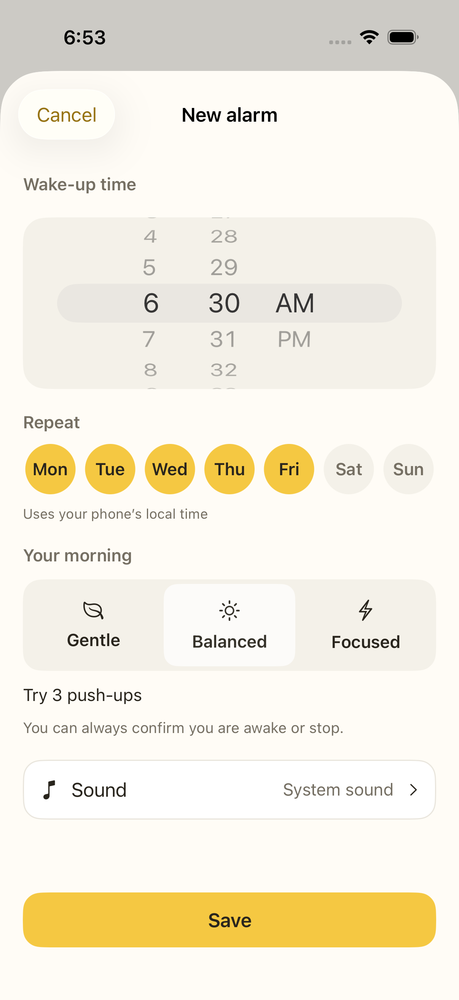 | 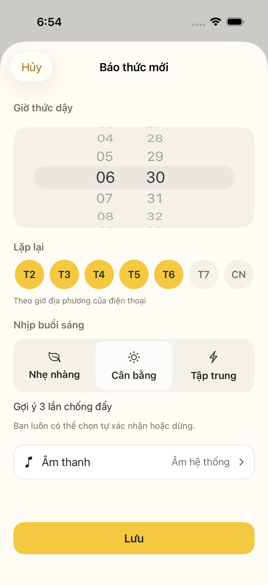 |
| Focused · five push-ups | 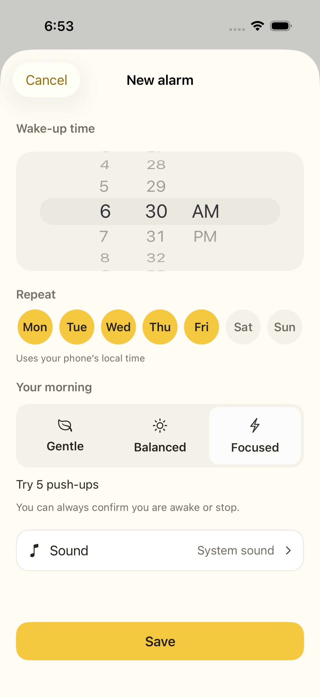 | 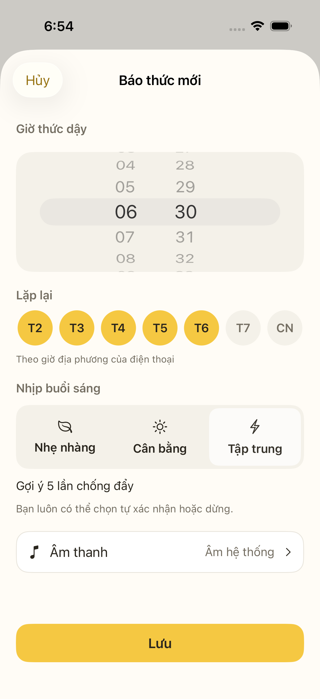 |
| Sound selection and preview volume |  |  |

### Try the morning flow

| Screen / state | English | Vietnamese |
|---|---|---|
| Rehearsal ready |  |  |
| Camera/cloud consent | 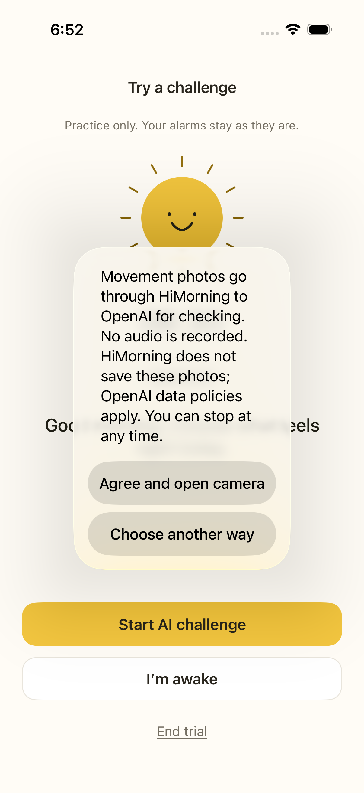 | 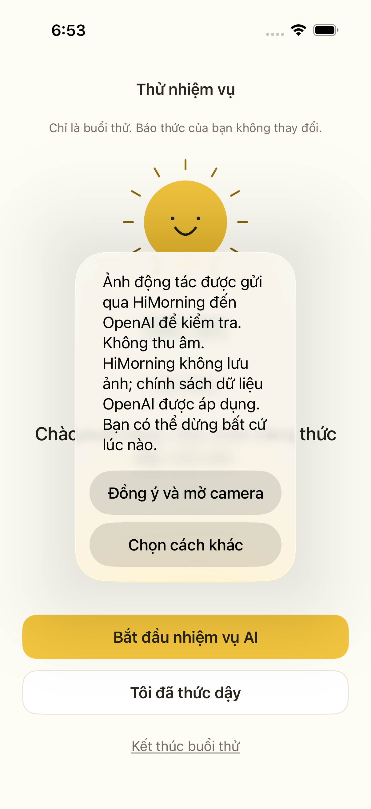 |
| AI unavailable · local choices remain | 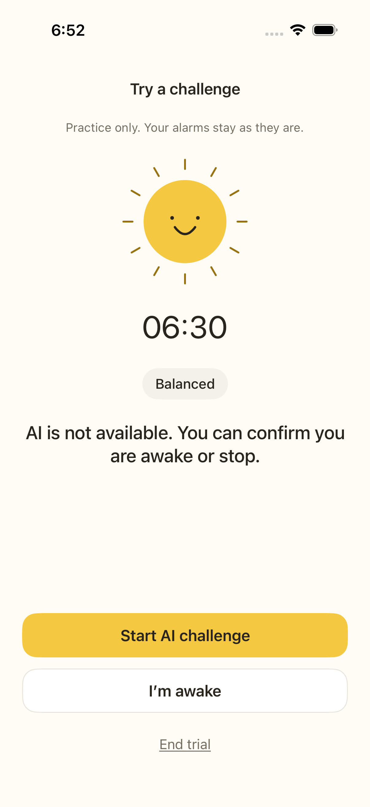 | 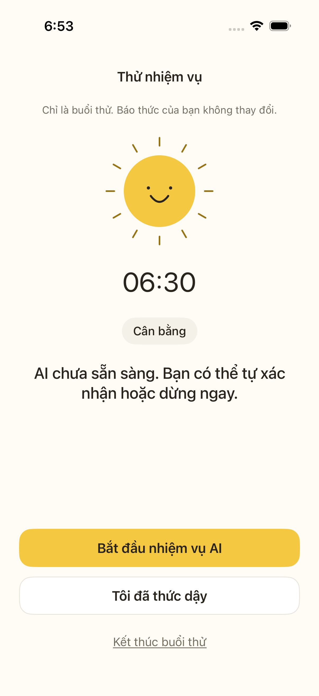 |
| Self-confirmed outcome | 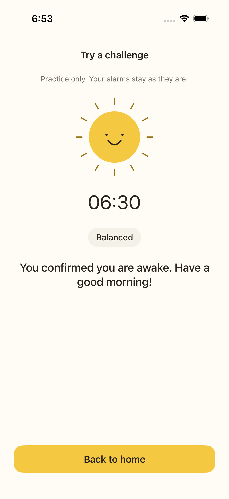 | 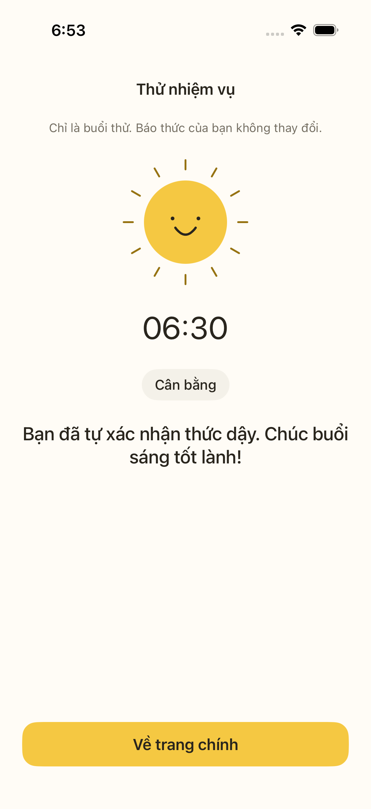 |
| Trial ended | 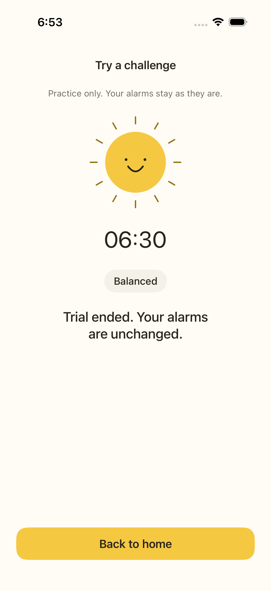 | 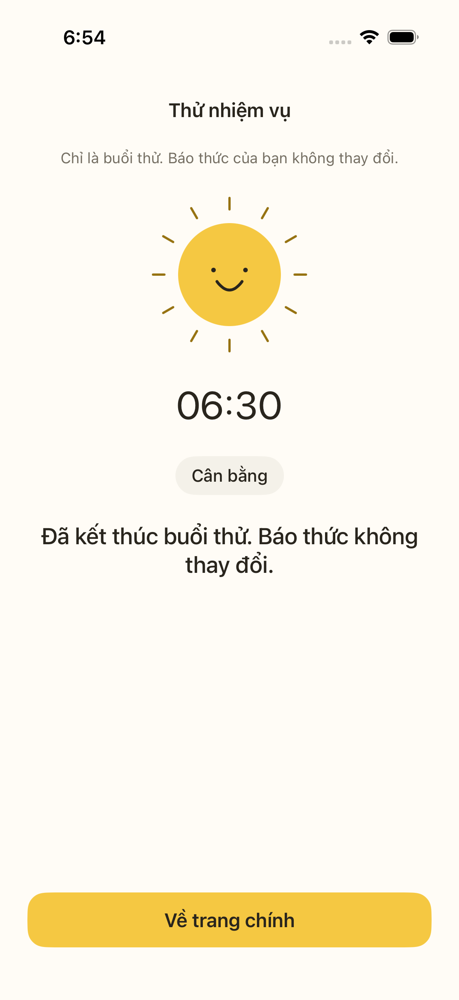 |

Open an image for full resolution. [Capture details](images/ui/README.md) record
the run, commit and simulator. The trial uses 06:30 as a sample time without
scheduling an alarm. Unavailable AI and self-confirmation are distinct outcomes;
these images do not show a paid AI verification or a live camera feed.

## Following the original design

The original [web study](../design/index.html) remains the visual reference. The
first native implementation used gray system groups and default yellow controls;
its four screenshots only covered Home and the top of the editor. That was an
incomplete implementation of the visual direction, not a new approved design.

| Original intent | Native implementation |
|---|---|
| Warm cream, sunshine yellow and brown text | Shared `MorningTheme.swift` palette across Home, editor, sounds and challenge |
| Compact header and calm type | Small sunrise brand, language menu, restrained headings and large alarm time |
| Rounded yellow actions and warm surfaces | 16pt action corners, 24pt alarm cards, adaptive light/dark surface colors |
| Days and modes easy to scan | Monday-first day buttons and three visible mode choices |
| A dedicated sound screen | Three actual native sounds, selection, preview and preview-volume control |
| Friendly sun and a clear way out | Sun illustration, consent, self-confirm and persistent stop/end-trial actions |

The native time picker keeps the platform wheel. System confirmation dialogs keep
iOS styling. Alarm labels, editable targets, QR, native snooze, history and the
prototype's six-sound collection are still planned; their simulated controls have
not been added to the native navigation.

## Design at a glance

- One clear next action on each screen, with a visible way to stop.
- Gentle defaults; stronger modes are a choice, not a personality label.
- Short, calm copy in both languages. See the [language guide](LOCALIZATION.md).
- Dark text on yellow buttons, clear focus and large touch areas.
- No ads, paywall or forced exercise in the morning stop path.

## Different mornings, one simple app

Leave room for work or school days, weekends, shift schedules and shared rooms.
Do not assume everyone has space, privacy or the ability to exercise in the morning.
A regular alarm must stay useful. Keep weekday choices editable, sound preview easy
to reach, and challenge consent separate from setting a time. Review the wording
with Vietnamese and English speakers rather than treating a literal translation as
proof of cultural fit.

## Look and feel

| Token | Light | Dark |
|---|---|---|
| Canvas | `#FFFCF6` | `#201F1A` |
| Surface | `#FFFFFF` | `#2C2A24` |
| Primary | `#F5C842` | `#F5C842` |
| Text on primary | `#29251D` | `#29251D` |
| Text | `#29251D` | `#F8F4EA` |
| Muted text | `#756F63` | `#C2BBAE` |
| Border | `#E9E5DC` | `#49463D` |
| Success text | `#44634A` | `#BDD6BF` |

`apps/ios/HiMorning/MorningTheme.swift` applies these values to native content.
The UI tests sample the rendered cream canvas and yellow primary action in both
languages. This protects those colors; it is not a complete pixel-snapshot or
accessibility audit. System fonts, flexible text, 44pt touch areas and dark text on
yellow keep the visual direction usable. The sun follows the original concept.

## Follow the main flow

| Screen | What the person needs | Current native scope |
|---|---|---|
| Home | See alarms and add one | Add, on/off, delete, try a challenge, language menu |
| New alarm | Set time without a long setup | Time, weekdays, mode and sound; Gentle default |
| Sound | Hear a sound before choosing it | System sound + two chime sketches; preview volume |
| Challenge | Understand consent and progress | Explicit consent, camera, provisional count, checking state |
| Finish | Know what happened | AI checked, self-confirmed or stopped; clear return action |
| History | See progress without shame | Planned; web study has sample data only |

The web study also includes QR and snooze simulations, an editor and weekly progress.
They must not be presented as native features. Review controls outside the phone
simulate events; they do not access a real camera or cloud model.

## Modes and choices

Gentle requires no exercise. Balanced suggests three push-ups, Focused five. The
current native pilot does not offer target editing or QR. Modes never change the
sound by themselves. A new choice should explain what changes before saving it.

The [challenge expansion proposal](AI-AND-CHALLENGES-PLAN.md) prioritizes offline
QR and short math, using one compact task selector and only its relevant goal.
Those controls are planned and are not shown as working native screens here.

The tested core has snooze budgets of two, one and zero five-minute periods.
Native snooze/countdown still needs implementation and device testing. Do not show
a working-looking snooze control until it actually schedules the intended behavior.

## Camera and feedback

Ask for camera/cloud consent only when a person chooses the challenge. Show one
short cue at a time. Poor visibility means insufficient evidence, not a wrong pose.
Local counts remain provisional until the backend checks the evidence.

Keep self-confirm and Stop available during capture, checking and errors. Do not
punish an unclear rep by adding more reps or extending the alarm. Deeper form advice
is optional future work with separate validation; see the [feedback plan](POSE-FEEDBACK-PLAN.md).

## Sound should be a choice

The design study explores six sound sketches in soft, bright and clear families.
The native pilot currently ships two original five-second chimes and system sound.
Only one preview plays at a time. Leaving the editor stops it.

Preview volume is not alarm volume. Before release, compare tone, loudness, peaks,
looping, device speakers, headphones and the effect on people sharing a room.
Volume ramps and ducking remain device/API questions, not promised controls.

## Review both languages

Check English and Vietnamese at small phone widths, large Dynamic Type and with
VoiceOver. Look for clipped buttons, unclear weekdays, focus problems and long
consent text. Use labels and symbols together; color alone should not carry meaning.
Respect reduced motion. Prefer explicit outcomes over streaks that erase progress.

The tests cover both editor languages, all three modes, sound selection, language
persistence, rendered brand colors and trial recovery/exit. Device and native
speaker review are still needed for sound, wording and layout. Large text, dark
mode and VoiceOver have not received a dedicated runtime review.

## Read next

[Language guide](LOCALIZATION.md) · [Architecture](ARCHITECTURE.md) · [Setup](RUNNING.md)

Research references: [Erly App Store](https://apps.apple.com/us/app/erly-wake-up-early/id6751428380),
[Erly Google Play](https://play.google.com/store/apps/details?id=com.erly.myapp&hl=en),
[Apple accessibility](https://developer.apple.com/design/human-interface-guidelines/accessibility).
